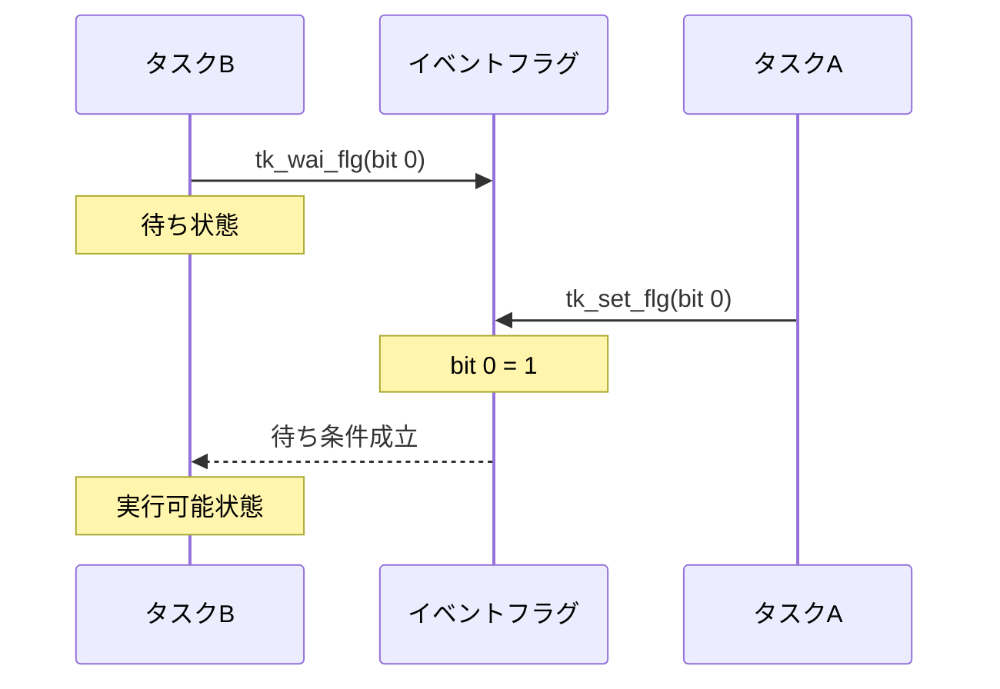
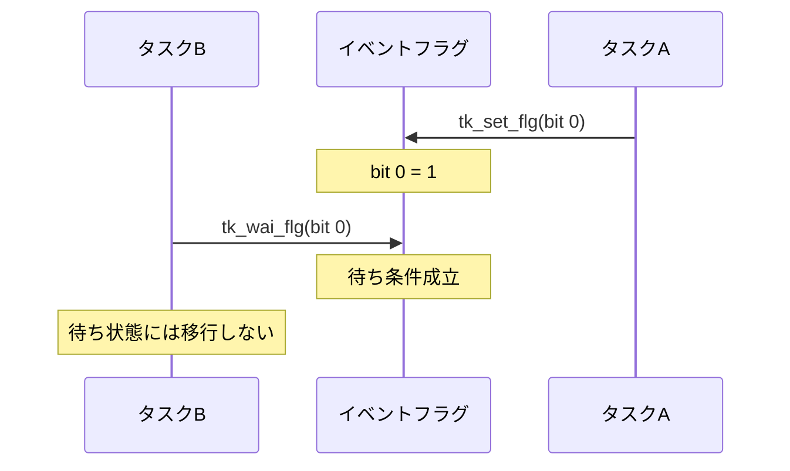
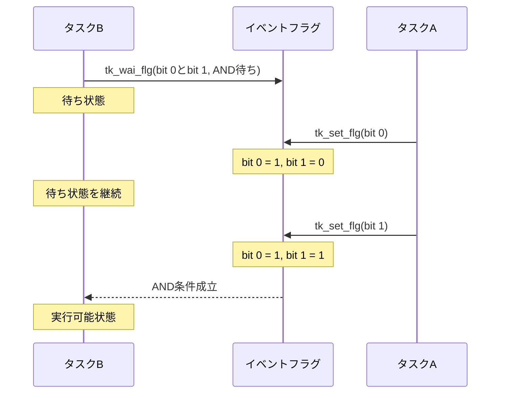
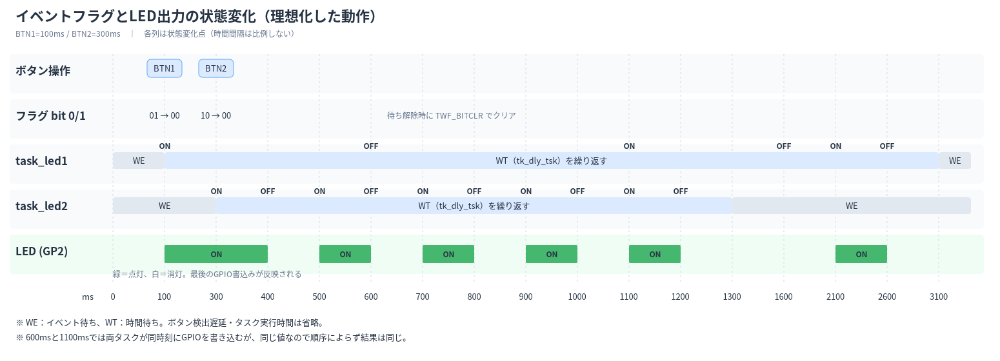

## はじめに

本記事は、CQ出版社『Interface』2023年7月号の特集「ラズパイPicoで1500行 ゼロから作るOS」で紹介されたリアルタイムOS「Try Kernel」を題材に、OSの仕組みを実機で学ぶシリーズの一部です。

前回の記事「[Try Kernelのタスク付属同期 — タスクを待たせる・起こす](https://zenn.dev/helowota/articles/pico-trykernel-task-sync)」では、`tk_slp_tsk()` と `tk_wup_tsk()` を使って、タスクの起床待ちと起床要求の仕組みを学びました。

タスク付属同期では、あるタスクから別のタスクへ起床要求を送り、処理を開始させることができます。

しかし、実際の組込みシステムでは、複数の条件に応じてタスクの処理を開始したい場合もあります。

例えば、2つのセンサを使用する場合を考えてみます。

- センサAの測定が完了したら処理を開始する
- センサBの測定が完了したら処理を開始する
- センサAとセンサBの両方の測定が完了したら処理を開始する

このような条件を扱うために用意されている同期機能の一つが、**イベントフラグ**です。

今回は、Try Kernelのイベントフラグを使って、複数の条件によるタスクの同期を学びます。

## イベントフラグとは？

イベントフラグは、イベントの**発生状態をビット列で表現する**同期機能です。

[前回](https://zenn.dev/helowota/articles/pico-trykernel-task-sync)のタスク付属同期では、起床要求の「回数」を管理していました。一方、イベントフラグでは、イベントが発生したかどうかという「状態」を管理します。

また、タスク付属同期とは異なり、イベントフラグは**タスクから独立したカーネルオブジェクト**として管理されます。

Try Kernelでは、1つのイベントフラグを32ビットのビット列で表現し、それぞれのビットに異なる意味を持たせることができます。

例えば、次のように割り当てることができます。

| ビット | 発生時の値 | 意味 |
|---|---|---|
| bit 0 | 1 | センサAの測定完了 |
| bit 1 | 1 | センサBの測定完了 |
| bit 2 | 1 | データ保存完了 |
| bit 3〜31 | — | 未使用（予約） |

※この表は割り当ての例です。

各ビットは、0がイベント未発生、1がイベント発生を表します。

イベントが発生すると、対応するビットを1にセットします。

タスクは、必要なビットがセットされるまで待ち状態になることができます。

### AND待ちとOR待ち

イベントフラグでは、各ビットで表現したイベントの発生状態を組み合わせて、タスクの待ち条件を指定できます。

代表的なのが、AND待ちとOR待ちです。

**AND待ち**は、指定したすべてのビットがセットされるまで待つ方法です。

例えば、bit 0とbit 1の両方が1になると待ち条件が成立し、**タスクの待ち状態が解除されます**。

**OR待ち**は、指定したビットのうち、いずれかがセットされるまで待つ方法です。

例えば、bit 0またはbit 1のどちらかが1になると待ち条件が成立し、**タスクの待ち状態が解除されます**。

| フラグの状態 | AND待ち（bit 0とbit 1） | OR待ち（bit 0またはbit 1） |
|---|---|---|
| `00` | 待つ | 待つ |
| `01` | 待つ | 解除 |
| `10` | 待つ | 解除 |
| `11` | 解除 | 解除 |

このように、**複数のイベントの発生状態を組み合わせて、タスクの待ち条件を指定できる**ことが、イベントフラグの特徴です。

### タスク付属同期との違い

もう一つ重要なのが、イベントの保持方法です。

タスク付属同期では、起床要求の**回数**を `wupcnt` に保持していました。

例えば、起床要求が3回届けば、その回数を保持できます。

一方、イベントフラグでは、イベントの**発生状態**を各ビットの0か1で保持します。

同じビットを何度セットしても、値は1のままです。

| 項目 | タスク付属同期 | イベントフラグ |
|---|---|---|
| 管理するもの | 起床要求の回数 | イベントの有無 |
| 保持方法 | `wupcnt` | ビットパターン |
| 同じ要求が複数回届いた場合 | 回数を保持する | 同じビットは1のまま |
| 同期の対象 | 特定のタスク | 複数のタスクから利用可能 |
| 待ち条件 | 起床要求 | AND待ち・OR待ち |

では、どのように使い分ければよいのでしょうか。

例えば、ボタンを押すたびにLEDを1秒間点灯させたい場合を考えます。

ボタンが短時間に3回押された場合、タスク付属同期なら起床要求を蓄積できるため、LED制御タスクは3回分の処理を実行できます。これは[前回の記事](https://zenn.dev/helowota/articles/pico-trykernel-task-sync)で確認した動作です。

一方、2つのセンサが両方とも測定完了の状態になったら処理を開始したい場合は、イベントフラグが適しています。

センサAとセンサBの測定完了を別々のビットに割り当て、AND待ちを使えば、両方の条件が成立するまでタスクを待たせることができます。

つまり、単純な起床通知やその回数を管理したい場合はタスク付属同期、複数のイベントの発生状態を区別・組み合わせて管理したい場合はイベントフラグが適しています。

---

## Try Kernelのイベントフラグ機能

書籍では、第4部 第2章（P.85〜）でイベントフラグの仕組みと実装を解説しています。

ここでは、アプリケーションから使用するAPIに注目します。

Try Kernelでは、次の4つの基本APIを使用します。

| API | 機能 |
|---|---|
| `tk_cre_flg` | イベントフラグを生成する |
| `tk_set_flg` | 指定したビットをセットする |
| `tk_clr_flg` | 指定したビットをクリアする |
| `tk_wai_flg` | 指定したビットの条件が成立するまで待つ |

### イベントフラグを生成する：tk_cre_flg

```c
ID tk_cre_flg(const T_CFLG *pk_cflg);
```

イベントフラグを生成するAPIです。

引数 `pk_cflg` には、イベントフラグの生成情報を格納した `T_CFLG` 構造体へのポインタを指定します。

```c
typedef struct t_cflg {
    ATR  flgatr;     /* イベントフラグ属性 */
    UINT iflgptn;    /* イベントフラグ初期値 */
} T_CFLG;
```

- `flgatr`：イベントフラグの待ち方などの動作条件を指定します。具体的な属性は、後ほどサンプルコードとともに説明します。
- `iflgptn`：生成時のビットパターンを指定します。

イベントフラグを生成するには、あらかじめ `T_CFLG` 型の変数に属性と初期ビットパターンを設定しておきます。その変数のアドレスを `tk_cre_flg()` に渡すことで、指定した条件のイベントフラグを生成できます。

生成に成功すると、イベントフラグIDが返されます。このIDを使用して、イベントフラグのセットや待ちを行います。

### イベントフラグをセットする：tk_set_flg

```c
ER tk_set_flg(ID flgid, UINT setptn);
```

指定したイベントフラグのビットをセットするAPIです。

`flgid` にはイベントフラグID、`setptn` にはセットするビットパターンを指定します。

例えば、bit 0をセットする場合は次のようにします。

```c
tk_set_flg(flgid, (1<<0));
```

bit 0とbit 1の両方をセットする場合は、次のように指定できます。

```c
tk_set_flg(flgid, (1<<0) | (1<<1));
```

`<<` は左シフト演算子で、左側の値を右側で指定したビット数だけ左にずらします。

例えば、`1 << 0` は1を0ビット左にシフトするため、結果は `0001`（2進数）となります。`1 << 1` は1を1ビット左にシフトするため、結果は `0010`（2進数）となります。

つまり、`1 << 0` はbit 0、`1 << 1` はbit 1をセットするためのビットパターンを生成します。

| 式 | 2進数（下位4ビット） |
|---|---|
| `1 << 0` | `0001` |
| `1 << 1` | `0010` |
| `(1 << 0) \| (1 << 1)` | `0011` |

`|` はビット単位の論理和（OR）です。これにより、複数のビットを同時に指定できます。

既存のフラグ値と指定したビットパターンの論理和（OR）によって、フラグが更新されます。


### イベントフラグをクリアする：tk_clr_flg

```c
ER tk_clr_flg(ID flgid, UINT clrptn);
```

指定したイベントフラグのビットをクリアするAPIです。

ここで注意したいのは、**クリアするビットではなく、残したいビットを1にしたパターンを指定する**ことです。

例えば、bit 0だけをクリアする場合は次のようにします。

```c
tk_clr_flg(flgid, ~(1<<0));
```

`~` はビット単位の否定（NOT）演算子で、各ビットの0と1を反転します。

`1 << 0` はbit 0だけが1のビットパターンです。これに `~` を付けると、bit 0だけが0で、それ以外のビットが1になります。

| 式 | 2進数（下位4ビット） |
|---|---|
| `1 << 0` | `0001` |
| `~(1 << 0)` | `1110` |

`tk_clr_flg()` は、現在のフラグ値と指定したビットパターンの論理積（AND）を取ってフラグを更新します。

例えば、現在のフラグ値が `0011`（bit 0とbit 1がセットされた状態）なら、次のようになります。

```text
  0011  現在のフラグ値
& 1110  クリア用のビットパターン
------
  0010  更新後のフラグ値
```

このように、bit 0だけがクリアされ、bit 1はそのまま残ります。

### イベントフラグを待つ：tk_wai_flg

```c
ER tk_wai_flg(ID flgid, UINT waiptn, UINT wfmode,
              UINT *p_flgptn, TMO tmout);
```

指定したイベントフラグの条件が成立するまで待つAPIです。

主な引数は次のとおりです。

| 引数 | 意味 |
|---|---|
| `flgid` | イベントフラグID |
| `waiptn` | 待ち対象のビットパターン |
| `wfmode` | AND待ち・OR待ちなどの待ちモード |
| `p_flgptn` | 待ち解除時のフラグ値を受け取る領域 |
| `tmout` | タイムアウト時間 |

例えば、bit 0がセットされるまで待つ場合は、次のように指定します。

```c
UINT flgptn;

tk_wai_flg(flgid, (1<<0),
           TWF_ANDW | TWF_BITCLR,
           &flgptn, TMO_FEVR);
```

`TWF_ANDW` はAND待ち、`TWF_BITCLR` は条件成立時に対象のビットをクリアする指定です。

`TMO_FEVR` は、タイムアウトを設けずに待つ指定です。

すでに待ち条件が成立している場合は、待ち状態にならずに処理を継続します。

---

## イベントフラグによる同期の流れ

ここでは、2つのタスクがイベントフラグを使って連携する場合を考えます。

タスクAはイベントを通知し、タスクBはイベントを待つ役割です。

### 1. タスクがイベントを待つ

タスクBが `tk_wai_flg()` を呼び出します。

指定したビットがまだセットされていなければ、タスクBは待ち状態になります。



待ち条件が成立すると、タスクBは実行可能状態になります。

実際にCPUが割り当てられるタイミングは、スケジューリングによって決まります。

### 2. イベントが先に発生する

今度は、タスクAが先にイベントフラグをセットした場合です。



この場合、タスクBが後から `tk_wai_flg()` を呼び出しても、すでに条件が成立しているため、待ち状態には移行しません。

ただし、同じビットが何度セットされたかは保持されません。

この点が、前回学んだタスク付属同期との違いです。

### 3. 複数の条件を待つ

bit 0とbit 1の両方がセットされるまで待つ場合を考えます。



bit 0だけがセットされた時点では、AND条件が成立しないため、タスクBは待ち続けます。

bit 1もセットされると条件が成立し、タスクBは実行可能状態になります。

OR待ちの場合は、どちらか一方のビットがセットされた時点で条件が成立します。

---

## タスクの状態遷移を整理する

前回の記事では、`tk_slp_tsk()` による起床待ちを学びました。

今回は、新たに `tk_wai_flg()` によるイベントフラグ待ちが登場します。

```text
             tk_sta_tsk()
休止状態 ----------------------> 実行可能状態
                                     |
                                     | CPUが割り当てられる
                                     v
                                  実行状態
                                     |
                                     | tk_wai_flg()
                                     | 待ち条件が不成立
                                     v
                                  待ち状態
                                     |
                                     | イベントフラグの
                                     | 待ち条件が成立
                                     v
                                実行可能状態
```

これは、イベントフラグの待ち条件がまだ成立していない場合の簡略図です。

待ち条件が成立している場合、`tk_wai_flg()` を呼び出しても待ち状態には移行しません。

また、タイムアウト時間を指定した場合は、待ち条件が成立しなくても、指定時間の経過によって待ち状態が解除されます。

ここでも、**待ち状態が解除されることと、実際にCPUで実行されることは別**です。

---

## Try Kernelで実際に動かしてみる

ここからは、書籍P.91のリスト10「イベント・フラグ実験プログラムのタスク実行関数」に対応する著者公開のソースコードを使って、イベントフラグの動作を確認します。

今回のサンプルでは、ボタン検出タスクと2つのLED制御タスクを使用します。

### 使用するコードと開発環境

ソースコードは、著者の[GitHubリポジトリ](https://github.com/ytoyoyama/interface_trykernel)で公開されています。

- 使用するソースコード：`part_4/sect_2`
- サンプル・アプリケーション：`application/usermain.c`

開発環境は、[前回の記事](https://zenn.dev/helowota/articles/pico-trykernel-task-sync)と同じWindows 11上の環境を使用します。

| 項目 | 内容 |
|---|---|
| ターゲット | Raspberry Pi Pico W（RP2040）＋ Robo Pico |
| ビルド | GNU Make、Arm GNU Toolchain |
| 書き込み | OpenOCD、GDB |
| UART出力の確認 | Tera Term（115200 bps、8N1、フロー制御なし、受信改行LF） |
| デバッグプローブ | Pico互換ボード（CMSIS-DAP、UART） |
| 入力 | Robo Picoの押しボタン（GP20、GP21） |
| 出力 | Robo PicoのGrove 2にあるステータスLED（GP2） |

書籍のサンプルでは、GP13とGP14に接続した2つの押しボタンを使用します。

また、2つのLED制御タスクは、同じLED出力を操作します。

今回はRobo Picoに搭載された部品を利用するため、ボタン入力をGP20・GP21、LED出力をGP2に変更します。

具体的な変更箇所は、記事末尾のAppendixにまとめます。

### サンプルコードの処理の流れ

今回のアプリケーションでは、3つのタスクが1つのイベントフラグを共有して動作します。

**1. ボタン検出タスク**

2つの押しボタンの入力状態を100ms間隔で確認します。

ボタンが押されたことを検出すると、対応するイベントフラグのビットを `tk_set_flg()` でセットします。

**2. LED制御タスク1**

イベントフラグのbit 0がセットされるまで `tk_wai_flg()` で待ちます。

条件が成立すると、LEDを500ms点灯、500ms消灯する処理を3回繰り返します。

**3. LED制御タスク2**

イベントフラグのbit 1がセットされるまで待ちます。

条件が成立すると、LEDを100ms点灯、100ms消灯する処理を5回繰り返します。

どちらのLED制御タスクも、点滅処理を終えると再びイベントフラグを待ちます。

なお、2つのLED制御タスクは同じGPIOを操作します。そのため、両方のタスクが動作すると、LEDの点滅パターンは互いのGPIO操作の影響を受けます。

ここでは動作の概要を押さえ、実機で確認した後に、イベントフラグの生成や待ち条件をソースコードで詳しく見ていきます。

### 実機で確認すること

Robo Pico上の2つの押しボタンとステータスLEDを使用して、イベントフラグによるタスクの同期を確認します。

今回は、次の動作を確認します。

1. 一方のボタンを押すと、対応するイベントフラグがセットされる
2. bit 0に対応するボタンを押すと、LEDが1秒周期で3回点滅する
3. bit 1に対応するボタンを押すと、LEDが0.2秒周期で5回点滅する
4. UARTの出力から、それぞれのボタン操作が検出されていることを確認する

また、ソースコードと実行結果を照らし合わせ、**1つのイベントフラグに複数の条件を持たせ、それぞれのタスクが異なるビットを待てる仕組み**を確認します。

### ビルドと実機への書き込み

著者公開のソースコード `part_4/sect_2` を使用します。

Windows環境でビルドするためのMakefileを追加し、Robo Pico Boardに合わせてGPIOの割り当てを変更します。具体的な変更箇所は記事末尾のAppendixにまとめます。

| 用途 | 書籍のサンプル | Robo Pico Board |
|---|---|---|
| BTN1 | GP14 | GP20 |
| BTN2 | GP13 | GP21 |
| LED | GP25 | GP2 |

今回のサンプルでは、2つのLED制御タスクが同じLEDを操作します。

このMakefileは、[開発環境の構築記事](https://zenn.dev/helowota/articles/pico-trykernel-windows-env)で紹介したxPack Windows Build Tools導入済みの環境を前提とします。

`part_4/sect_2` ディレクトリに、以下の内容で `Makefile` を作成してください。

```makefile
# Try Kernel - Part 4, Section 2 (RP2040)

TARGET := trykernel
CC := arm-none-eabi-gcc
SIZE := arm-none-eabi-size
OBJDUMP := arm-none-eabi-objdump

CFLAGS := -mcpu=cortex-m0plus -mthumb -O0 -ffreestanding -std=c99 -Iinclude -g
LDFLAGS := -mcpu=cortex-m0plus -mthumb -T linker/pico_memmap.ld -nostartfiles

SRCS := boot/boot2.c \
        boot/reset_hdr.c \
        boot/vector_tbl.c \
        kernel/syslib.c \
        kernel/context.c \
        kernel/inittsk.c \
        kernel/scheduler.c \
        kernel/systimer.c \
        kernel/task_mange.c \
        kernel/task_queue.c \
        kernel/task_sync.c \
        kernel/eventflag.c \
        application/usermain.c

ASRCS := kernel/dispatch.S

OBJS := $(patsubst %.c,build/%.o,$(SRCS)) \
        $(patsubst %.S,build/%.o,$(ASRCS))

ELF := build/$(TARGET).elf

.PHONY: all clean size sections

all: $(ELF)

$(ELF): $(OBJS) linker/pico_memmap.ld
	$(CC) $(LDFLAGS) -o $@ $(OBJS)
	$(SIZE) $@

build/%.o: %.c
	@mkdir -p $(dir $@)
	$(CC) $(CFLAGS) -c $< -o $@

build/%.o: %.S
	@mkdir -p $(dir $@)
	$(CC) $(CFLAGS) -c $< -o $@

size: $(ELF)
	$(SIZE) $(ELF)

sections: $(ELF)
	$(OBJDUMP) -h $(ELF)

clean:
	rm -rf build
```

このMakefileでは、起動処理、カーネル、アプリケーションの各ソースをコンパイルし、`linker/pico_memmap.ld` を使用してリンクします。

今回のイベントフラグの実装は `kernel/eventflag.c` に含まれています。

`-O0` で最適化を無効にし、`-g` でデバッグ情報を付加しています。

PowerShellで `part_4/sect_2` に移動し、ビルドします。

```powershell
make clean
make
```

正常にビルドできると、`build/trykernel.elf` が生成されます。

今回の環境では、次の結果になりました。

```text
arm-none-eabi-size build/trykernel.elf
   text    data     bss     dec     hex filename
   6618      88    5540   12246    2fd6 build/trykernel.elf
```

続いて、Debug Probeを接続し、OpenOCDを起動します。

```powershell
openocd -f interface/cmsis-dap.cfg -f target/rp2040.cfg
```

別のPowerShellからGDBを起動します。

```powershell
arm-none-eabi-gdb .\build\trykernel.elf
```

GDBで以下を実行し、プログラムを書き込みます。

```text
target remote localhost:3333
monitor reset halt
load
monitor reset halt
```

書き込み後、UART出力を受信できる状態にしてから、GDBでプログラムを実行します。

```text
continue
```
---

## 動作結果を確認する

Try Kernelの起動メッセージやボタン操作による文字列出力は、Debug ProbeのUART経由で確認します。

Tera Termを起動し、Debug Probeのシリアルポートを選択します。

通信条件は前回の記事と同じ115200 bps、8 bit、パリティなし、ストップビット1 bit、フロー制御なし、受信改行コードLFです。

### ボタンを1つずつ押す

まず、BTN1とBTN2を個別に押して、それぞれの動作を確認します。

1. BTN1を短く押して離します。
2. LEDがゆっくり3回点滅し、点滅が終わるまで待ちます。
3. BTN2を短く押して離します。
4. LEDが速く5回点滅することを確認します。

BTN1では「500ms点灯・500ms消灯」を3回、BTN2では「100ms点灯・100ms消灯」を5回繰り返す想定です。

実機で確認したUART出力は次のとおりです。

```text
Strat Try Kernel
BTN-0 ON
BTN-1 ON
```

`Strat Try Kernel` はTry Kernelの起動メッセージです。`BTN-0 ON` と `BTN-1 ON` は、それぞれBTN1とBTN2を押したときに出力されます。

実機でも、BTN1ではゆっくり3回、BTN2では速く5回の点滅を確認できました。

この操作では、2つのLED制御タスクの点滅処理が重ならないため、それぞれの点滅速度と回数を確認できました。

### 点滅中にもう一方のボタンを押す

次に、2つのLED制御タスクの動作が重なる場合を確認します。

1. LEDが消灯している状態から、BTN1を短く押して離します。
2. LEDがゆっくり点滅している間に、BTN2を短く押して離します。
3. LEDの点滅がどのように変化するかを観察します。
4. 両方の点滅処理が終了するまで待ちます。

この操作では、2つのタスクが同じLEDを操作するため、個別にボタンを押した場合とは異なる点滅パターンになります。

BTN2を押したからといって、BTN1による点滅処理が終了するわけではありません。2つのタスクは、それぞれの点滅処理を進めます。

実機で確認したUART出力は次のとおりです。

```text
BTN-0 ON
BTN-1 ON
```

BTN1を押すとLEDがゆっくり点滅を始め、その途中でBTN2を押すと、高速点滅が割り込むように見えました。

高速点滅が終わると、再びゆっくりした点滅が現れ、最後にLEDが消灯しました。

では、ボタン操作によって、どのようにLED制御タスクが動き始めるのでしょうか。また、2つのタスクが同じLEDを操作すると、なぜ点滅パターンが変化するのでしょうか。

### BTN1とBTN2を同時に押すと？

最後に、BTN1とBTN2を同時に押した場合も確認しました。

5回試したところ、UARTには毎回、次の順序で出力されました。

```text
BTN-1 ON
BTN-0 ON
```

これは、ボタン検出タスク `task_btn()` が、BTN2、BTN1の順番で押下を判定しているためです。

100ms間隔の監視で両方の押下を同時に検出した場合、ソースコードに記述された順番で処理されます。

なお、これはボタン検出タスク内の処理順序であり、LED制御タスクの優先度を示すものではありません。

ここまで、ボタン操作によってLEDがどのように動作するかを確認しました。では、ボタン検出タスクからLED制御タスクへ、イベントの発生はどのように伝えられるのでしょうか。

ここからは、イベントフラグの仕組みと、サンプルコードでの使い方を確認していきます。

---

## サンプルコードで使うイベントフラグ

イベントフラグは、複数のイベントの発生状態をビットパターンで管理し、タスク間の同期に利用する仕組みです。

各ビットに意味を割り当て、イベントが発生したときに対応するビットをセットします。

今回のサンプルでは、BTN1とBTN2の操作を、それぞれbit 0とbit 1に割り当てています。

| ビット | 意味 |
|---|---|
| bit 0 | BTN1が押された |
| bit 1 | BTN2が押された |

例えば、イベントフラグの下位2ビットは次の状態を表します。

| ビットパターン | 状態 |
|---|---|
| `00` | どちらのイベントも発生していない |
| `01` | BTN1のイベントがセットされている |
| `10` | BTN2のイベントがセットされている |
| `11` | 両方のイベントがセットされている |

なお、ビットパターンはボタンの現在の押下状態ではなく、イベントフラグに保持されている状態を表します。

イベントフラグを待つタスクは、どのビットを待つかを指定できます。

今回のサンプルでは、LED制御タスク1はbit 0、LED制御タスク2はbit 1を待ちます。

このように、**1つのイベントフラグを複数のタスクで共有し、それぞれ異なる条件で待つことができます。**

## イベントフラグの生成

### イベントフラグの生成情報

今回のサンプルでは、イベントフラグの生成情報を保持する `cflg` と、生成したイベントフラグのIDを保持する `flgid` をグローバル変数として定義しています。

```c
/* イベントフラグ生成情報 */
ID flgid;
T_CFLG cflg = {
    .flgatr  = TA_TFIFO | TA_WMUL,  // イベントフラグ属性
    .iflgptn = 0,                   // イベントフラグ初期値
};
```

`cflg` は `T_CFLG` 型の変数で、イベントフラグの属性と初期値を設定します。

- `TA_TFIFO`：複数のタスクが待っている場合、待ち行列をFIFO順に管理します。
- `TA_WMUL`：複数のタスクが同じイベントフラグを同時に待つことを許可します。
- `iflgptn = 0`：生成時には、すべてのビットを0にします。

今回は、2つのLED制御タスクが同じイベントフラグを待つため、`TA_WMUL` を指定しています。

### usermain()での生成とタスク起動

`usermain()` では、イベントフラグを生成した後、ボタン検出タスクと2つのLED制御タスクを生成・起動します。

```c
int usermain(void)
{
    /* イベントフラグの生成*/
    flgid = tk_cre_flg(&cflg);

    /* ボタン検出タスクの生成、実行 */
    tskid_btn = tk_cre_tsk(&ctsk_btn);
    tk_sta_tsk(tskid_btn, 0);

    /* LED制御タスク1の生成、実行 */
    tskid_led1 = tk_cre_tsk(&ctsk_led1);
    tk_sta_tsk(tskid_led1, 0);

    /* LED制御タスク2の生成、実行 */
    tskid_led2 = tk_cre_tsk(&ctsk_led2);
    tk_sta_tsk(tskid_led2, 0);

    return 0;
}
```

まず、tk_cre_flg() に、前の項で定義したイベントフラグ生成情報 cflg のアドレスを渡して、イベントフラグを生成します。

```c
flgid = tk_cre_flg(&cflg);
```

生成されたイベントフラグは、`cflg` で指定した属性 `TA_TFIFO | TA_WMUL` と、初期ビットパターン `0` を持ちます。

`tk_cre_flg()` は生成したイベントフラグのIDを返し、そのIDを `flgid` に保存します。以降、各タスクはこのIDを指定して、同じイベントフラグを操作します。

続いて、ボタン検出タスクと2つのLED制御タスクを生成・起動します。

`ctsk_btn`、`ctsk_led1`、`ctsk_led2` は、それぞれのタスクの生成情報を保持する `T_CTSK` 型の変数です。`tk_cre_tsk()` でタスクを生成し、`tk_sta_tsk()` で起動します。

タスクの生成・起動と状態遷移については、前回の「Try Kernelのタスク管理」で説明しました。

今回のサンプルでは、起動した3つのタスクが次のようにイベントフラグを利用します。

- **ボタン検出タスク**：ボタンが押されると、`tk_set_flg()` で対応するビットをセットします。
- **LED制御タスク1**：`tk_wai_flg()` でbit 0がセットされるのを待ちます。
- **LED制御タスク2**：`tk_wai_flg()` でbit 1がセットされるのを待ちます。

このように、`usermain()` で生成した1つのイベントフラグを、3つのタスクが共有して動作します。

次に、各タスクがイベントフラグをどのように操作するかを確認します。

## ボタン検出タスク

ボタン検出タスク `task_btn()` は、BTN1とBTN2の入力を100ms間隔で監視します。

ボタンが押されたことを検出すると、`tk_set_flg()` を使用してイベントフラグの対応するビットをセットします。

| ボタン | GPIO | セットするビット | ビットパターン |
|---|---|---|---|
| BTN1 | GP20 | bit 0 | `01` |
| BTN2 | GP21 | bit 1 | `10` |

```c
tk_set_flg(flgid, (1<<0));  // BTN1
tk_set_flg(flgid, (1<<1));  // BTN2
```

`tk_set_flg()` の第1引数にはイベントフラグID、第2引数にはセットするビットパターンを指定します。

BTN1が押されるとbit 0、BTN2が押されるとbit 1がセットされます。

なお、GP20とGP21はRobo Pico Boardに合わせて変更したGPIOです。書籍のサンプルでは、それぞれGP14とGP13を使用しています。

## LED制御タスク

LED制御タスクは、イベントフラグの対応するビットがセットされるまで待ちます。

今回のサンプルでは、2つのLED制御タスクが異なるビットを待ち、それぞれ異なる速度でLEDを点滅させます。

### LED制御タスク1

```c
/* LED制御タスク1の実行関数 */
void task_led1(INT stacd, void *exinf)
{
    UINT flgptn;
    while(1) {
        tk_wai_flg(flgid, (1<<0), TWF_ANDW | TWF_BITCLR, &flgptn, TMO_FEVR);
        for(INT i = 0; i <3; i++) {
            out_w(GPIO_OUT_SET, (1<<2));
            tk_dly_tsk(500);
            out_w(GPIO_OUT_CLR, (1<<2));
            tk_dly_tsk(500);
        }
    }
}
```

`task_led1()` は、イベントフラグのbit 0がセットされるまで待ちます。

```c
tk_wai_flg(flgid, (1<<0), TWF_ANDW | TWF_BITCLR, &flgptn, TMO_FEVR);
```

- `(1<<0)`：bit 0を待ち条件に指定します。
- `TWF_ANDW`：指定したすべてのビットがセットされた場合に待ちを解除します。
- `TWF_BITCLR`：待ち条件が成立した際、条件に指定したビットをクリアします。
- `&flgptn`：待ち解除時のビットパターンを受け取ります。
- `TMO_FEVR`：タイムアウトせず、条件が成立するまで待ち続けます。

今回はbit 0だけを指定しているため、AND条件とOR条件の違いは現れません。

待ちが解除されると、LEDを500ms点灯、500ms消灯する処理を3回繰り返します。

点滅処理が終了すると `while(1)` の先頭に戻り、再びイベントフラグのbit 0を待ちます。

### LED制御タスク2

```c
/* LED制御タスク2の実行関数 */
void task_led2(INT stacd, void *exinf)
{
    UINT flgptn;
    while(1) {
        tk_wai_flg(flgid, (1<<1), TWF_ANDW | TWF_BITCLR, &flgptn, TMO_FEVR);
        for(INT i = 0; i <5; i++) {
            out_w(GPIO_OUT_SET, (1<<2));
            tk_dly_tsk(100);
            out_w(GPIO_OUT_CLR, (1<<2));
            tk_dly_tsk(100);
        }
    }
}
```

`task_led2()` は、イベントフラグのbit 1がセットされるまで待ちます。

```c
tk_wai_flg(flgid, (1<<1), TWF_ANDW | TWF_BITCLR, &flgptn, TMO_FEVR);
```

待ち条件はbit 1で、それ以外の指定は `task_led1()` と同じです。

待ちが解除されると、LEDを100ms点灯、100ms消灯する処理を5回繰り返します。

点滅処理が終了すると、再びイベントフラグのbit 1を待ちます。

2つのタスクの動作を整理すると、次のようになります。

| 項目 | task_led1 | task_led2 |
|---|---|---|
| 待ち条件 | bit 0（BTN1） | bit 1（BTN2） |
| 点灯時間 | 500ms | 100ms |
| 消灯時間 | 500ms | 100ms |
| 繰り返し回数 | 3回 | 5回 |
| 点滅処理の合計時間 | 3000ms | 1000ms |
| 制御するGPIO | GP2 | GP2 |

どちらのタスクも、Robo Pico Boardの同じLED（GP2）を操作します。

したがって、両方のタスクが同時期に点滅処理を実行すると、一方のタスクによるLED出力の変更が、もう一方のタスクの点滅動作に影響します。

## 状態変化点を抜き出したタイムチャート

BTN1を100ms、BTN2を300msで押した場合の動作をタイムチャートに示します。

図が横長になるのを避けるため、タスクの実行再開やLED出力の変更など、状態が変化する時刻だけを抜き出しています。

横軸は時刻（ms）ですが、列の間隔は実際の経過時間に比例していません。

また、ボタン検出の遅延やタスクの実行時間は省略し、押下した時刻にイベントフラグがセットされるものとします。



タイムチャートでは、イベントフラグによる待ち（WE）と、`tk_dly_tsk()` による時間待ち（WT）を区別しています。

BTN1が押されると `task_led1` のイベント待ちが解除され、500ms間隔の点滅処理が始まります。

続いてBTN2が押されると `task_led2` のイベント待ちが解除され、100ms間隔の点滅処理が始まります。

それぞれのタスクは、`tk_dly_tsk()` で時間待ちに入るため、一方が待っている間にも、もう一方のタスクが処理を進めることができます。

また、両タスクが同じLEDを操作するため、LEDの出力は、それぞれのタスクが最後に行ったGPIO操作によって決まります。

## 実機で動かして分かったこと

実機では、BTN1とBTN2を個別に押すと、それぞれ指定した速度と回数でLEDが点滅することを確認できました。

また、BTN1によるゆっくりした点滅の途中でBTN2を押すと、高速点滅が割り込むように見え、その後ゆっくりした点滅が再び現れました。

今回注目したいのは、**1つのイベントフラグを複数のタスクが利用し、それぞれ異なる条件で処理を開始できる**という点です。

前回のタスク付属同期では、起床要求を受け取るタスクを指定していました。

一方、イベントフラグでは、タスクが待つ条件をビットパターンで指定します。

これにより、イベントの種類と、それを待つタスクの処理を分けて考えられます。

また、イベントフラグによってタスクの待ちを解除することと、その後に複数のタスクが同じGPIOを操作することは別の問題です。

今回のサンプルでは、2つのLED制御タスクが独立して点滅処理を進める一方で、同じGPIOへの操作が重なることで、実際のLED出力が変化することを確認できました。

---

## おわりに

今回は、Try Kernelのイベントフラグを使い、ビットパターンによるイベントの管理と、タスク間の同期について学びました。

イベントフラグを使うことで、1つの同期オブジェクトに複数のイベントを割り当て、タスクごとに異なる条件で待つことができます。

一方、複数のタスクが同じ資源を操作する場合には、同期だけでなく、資源へのアクセスを適切に制御することも重要になります。

次回は、こうした資源の競合を防ぐための**セマフォによる排他制御**を取り上げます。

## 参考資料

- CQ出版社『Interface』2023年7月号「ラズパイPicoで1500行 ゼロから作るOS」
  - 第4部 第1章「主に1対1のタスク同期に使われる…起床待ちと起床」
  - 第4部 第2章「複数のタスク間で複雑な同期もできる…イベント・フラグ」
- [Try Kernel 著者公開ソースコード](https://github.com/ytoyoyama/interface_trykernel)
- [Try Kernelのタスク管理 — なぜOSが必要なのか？](https://zenn.dev/helowota/articles/pico-trykernel-task-management)
- [Try Kernelのタスク付属同期 — タスクを待たせる・起こす](https://zenn.dev/helowota/articles/pico-trykernel-task-sync)

---

## Appendix：Robo Pico向けのGPIO設定

書籍のサンプルコードでは、ボタン入力とLED出力に使用するGPIOが、Robo Pico Boardの配線と異なります。

今回も前回のタスク付属同期編と同様に、GPIOの割り当てを変更しました。

| 用途 | 書籍の設定 | Robo Pico Board |
|---|---|---|
| BTN1 | GP14 | GP20 |
| BTN2 | GP13 | GP21 |
| LED | GP25 | GP2 |

変更対象は、`application/usermain.c` と `boot/reset_hdr.c` です。

具体的な変更方法については、前回の[タスク付属同期編](https://zenn.dev/helowota/articles/pico-trykernel-task-sync)を参照してください。
