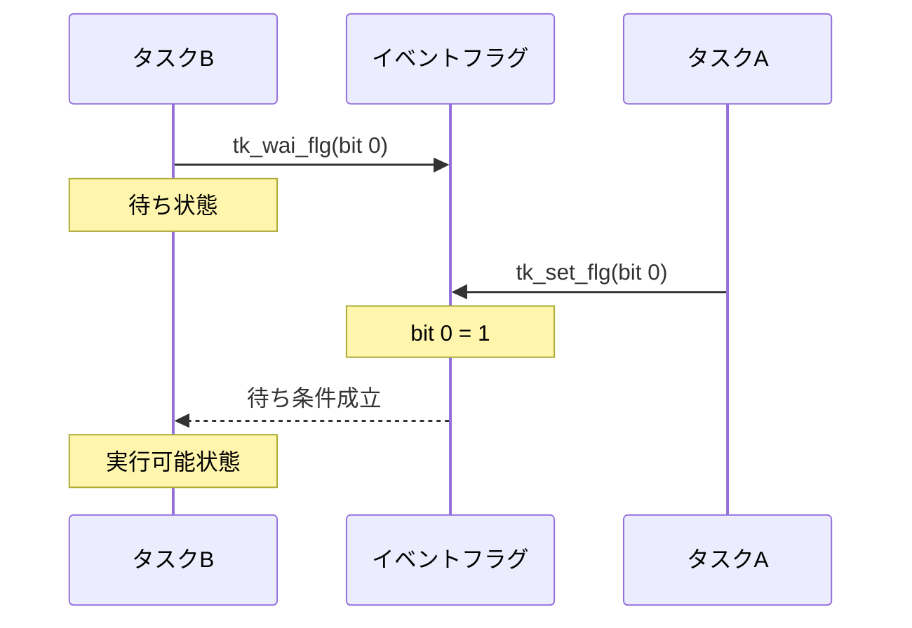
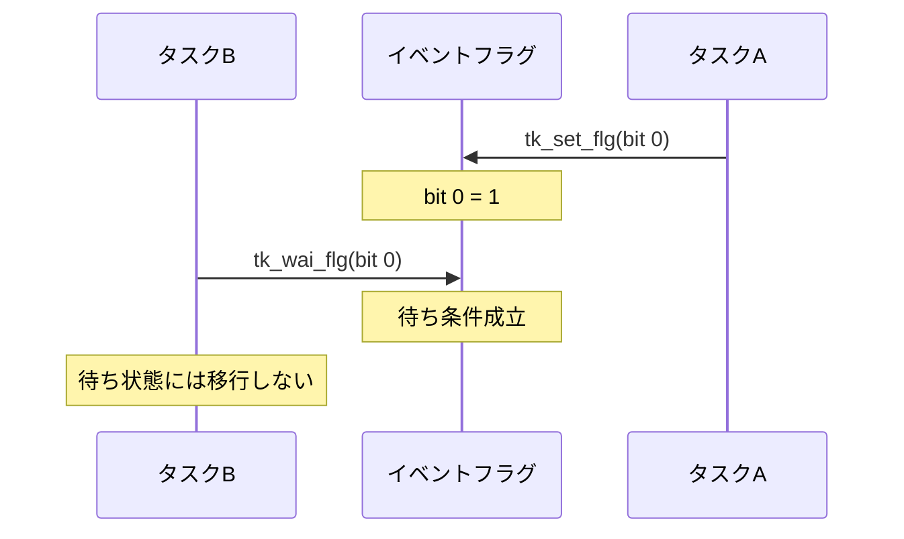
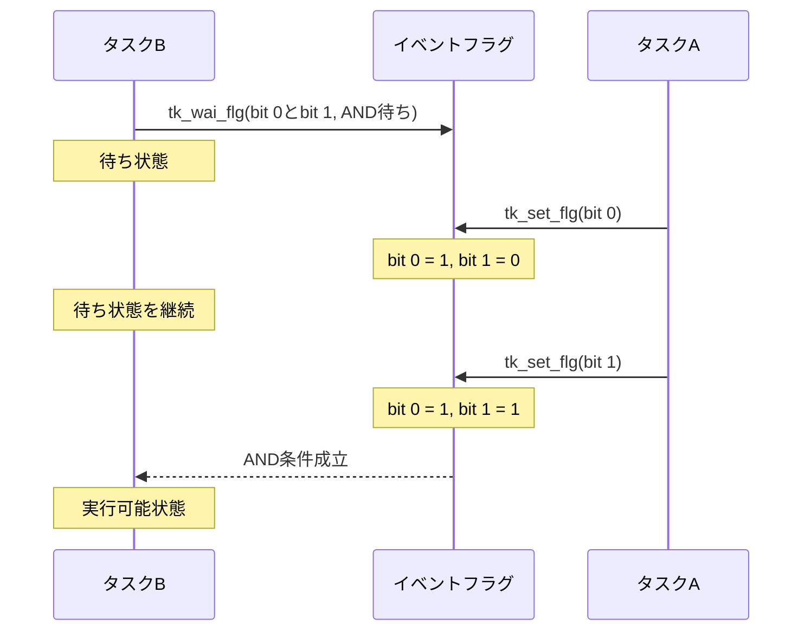

## はじめに

前回の記事「[Try Kernelのタスク付属同期 — タスクを待たせる・起こす](https://zenn.dev/helowota/articles/pico-trykernel-task-sync)」では、`tk_slp_tsk()` と `tk_wup_tsk()` を使って、タスクの起床待ちと起床要求の仕組みを学びました。

タスク付属同期では、あるタスクから別のタスクへ起床要求を送り、処理を開始させることができます。

しかし、実際の組込みシステムでは、複数の条件に応じてタスクの処理を開始したい場合もあります。

例えば、2つのセンサを使用する場合を考えてみます。

- センサAの測定が完了したら処理を開始する
- センサBの測定が完了したら処理を開始する
- センサAとセンサBの両方の測定が完了したら処理を開始する

このような条件を扱うために用意されている同期機能の一つが、**イベントフラグ**です。

今回は、Try Kernelのイベントフラグを使って、複数の条件によるタスクの同期を学びます。

## イベントフラグとは？

イベントフラグは、イベントの**発生状態をビット列で表現する**同期機能です。

[前回](https://zenn.dev/helowota/articles/pico-trykernel-task-sync)のタスク付属同期では、起床要求の「回数」を管理していました。一方、イベントフラグでは、イベントが発生したかどうかという「状態」を管理します。

また、タスク付属同期とは異なり、イベントフラグは**タスクから独立したカーネルオブジェクト**として管理されます。

Try Kernelでは、1つのイベントフラグを32ビットのビット列で表現し、それぞれのビットに異なる意味を持たせることができます。

例えば、次のように割り当てることができます。

| ビット | 発生時の値 | 意味 |
|---|---|---|
| bit 0 | 1 | センサAの測定完了 |
| bit 1 | 1 | センサBの測定完了 |
| bit 2 | 1 | データ保存完了 |
| bit 3〜31 | — | 未使用（予約） |

※この表は割り当ての例です。

各ビットは、0がイベント未発生、1がイベント発生を表します。

イベントが発生すると、対応するビットを1にセットします。

タスクは、必要なビットがセットされるまで待ち状態になることができます。

### AND待ちとOR待ち

イベントフラグでは、各ビットで表現したイベントの発生状態を組み合わせて、タスクの待ち条件を指定できます。

代表的なのが、AND待ちとOR待ちです。

**AND待ち**は、指定したすべてのビットがセットされるまで待つ方法です。

例えば、bit 0とbit 1の両方が1になると待ち条件が成立し、**タスクの待ち状態が解除されます**。

**OR待ち**は、指定したビットのうち、いずれかがセットされるまで待つ方法です。

例えば、bit 0またはbit 1のどちらかが1になると待ち条件が成立し、**タスクの待ち状態が解除されます**。

| フラグの状態 | AND待ち（bit 0とbit 1） | OR待ち（bit 0またはbit 1） |
|---|---|---|
| `00` | 待つ | 待つ |
| `01` | 待つ | 解除 |
| `10` | 待つ | 解除 |
| `11` | 解除 | 解除 |

このように、**複数のイベントの発生状態を組み合わせて、タスクの待ち条件を指定できる**ことが、イベントフラグの特徴です。

### タスク付属同期との違い

もう一つ重要なのが、イベントの保持方法です。

タスク付属同期では、起床要求の**回数**を `wupcnt` に保持していました。

例えば、起床要求が3回届けば、その回数を保持できます。

一方、イベントフラグでは、イベントの**発生状態**を各ビットの0か1で保持します。

同じビットを何度セットしても、値は1のままです。

| 項目 | タスク付属同期 | イベントフラグ |
|---|---|---|
| 管理するもの | 起床要求の回数 | イベントの有無 |
| 保持方法 | `wupcnt` | ビットパターン |
| 同じ要求が複数回届いた場合 | 回数を保持する | 同じビットは1のまま |
| 同期の対象 | 特定のタスク | 複数のタスクから利用可能 |
| 待ち条件 | 起床要求 | AND待ち・OR待ち |

では、どのように使い分ければよいのでしょうか。

例えば、ボタンを押すたびにLEDを1秒間点灯させたい場合を考えます。

ボタンが短時間に3回押された場合、タスク付属同期なら起床要求を蓄積できるため、LED制御タスクは3回分の処理を実行できます。これは[前回の記事](https://zenn.dev/helowota/articles/pico-trykernel-task-sync)で確認した動作です。

一方、2つのセンサが両方とも測定完了の状態になったら処理を開始したい場合は、イベントフラグが適しています。

センサAとセンサBの測定完了を別々のビットに割り当て、AND待ちを使えば、両方の条件が成立するまでタスクを待たせることができます。

つまり、単純な起床通知やその回数を管理したい場合はタスク付属同期、複数のイベントの発生状態を区別・組み合わせて管理したい場合はイベントフラグが適しています。

---

## Try Kernelのイベントフラグ機能

書籍では、第4部 第2章（P.85〜）でイベントフラグの仕組みと実装を解説しています。

ここでは、アプリケーションから使用するAPIに注目します。

Try Kernelでは、次の4つの基本APIを使用します。

| API | 機能 |
|---|---|
| `tk_cre_flg` | イベントフラグを生成する |
| `tk_set_flg` | 指定したビットをセットする |
| `tk_clr_flg` | 指定したビットをクリアする |
| `tk_wai_flg` | 指定したビットの条件が成立するまで待つ |

### イベントフラグを生成する：tk_cre_flg

```c
ID tk_cre_flg(const T_CFLG *pk_cflg);
```

イベントフラグを生成するAPIです。

生成情報は `T_CFLG` 構造体で指定します。

```c
typedef struct t_cflg {
    ATR  flgatr;     /* イベントフラグ属性 */
    UINT iflgptn;    /* イベントフラグ初期値 */
} T_CFLG;
```

`iflgptn` には、生成時のビットパターンを指定します。

生成に成功すると、イベントフラグIDが返されます。

### イベントフラグをセットする：tk_set_flg

```c
ER tk_set_flg(ID flgid, UINT setptn);
```

指定したイベントフラグのビットをセットするAPIです。

`flgid` にはイベントフラグID、`setptn` にはセットするビットパターンを指定します。

例えば、bit 0をセットする場合は次のようにします。

```c
tk_set_flg(flgid, (1<<0));
```

bit 0とbit 1の両方をセットする場合は、次のように指定できます。

```c
tk_set_flg(flgid, (1<<0) | (1<<1));
```

`<<` は左シフト演算子で、左側の値を右側で指定したビット数だけ左にずらします。

例えば、`1 << 0` は1を0ビット左にシフトするため、結果は `0001`（2進数）となります。`1 << 1` は1を1ビット左にシフトするため、結果は `0010`（2進数）となります。

つまり、`1 << 0` はbit 0、`1 << 1` はbit 1をセットするためのビットパターンを生成します。

| 式 | 2進数（下位4ビット） |
|---|---|
| `1 << 0` | `0001` |
| `1 << 1` | `0010` |
| `(1 << 0) \| (1 << 1)` | `0011` |

`|` はビット単位の論理和（OR）です。これにより、複数のビットを同時に指定できます。

既存のフラグ値と指定したビットパターンの論理和（OR）によって、フラグが更新されます。


### イベントフラグをクリアする：tk_clr_flg

```c
ER tk_clr_flg(ID flgid, UINT clrptn);
```

指定したイベントフラグのビットをクリアするAPIです。

ここで注意したいのは、**クリアするビットではなく、残したいビットを1にしたパターンを指定する**ことです。

例えば、bit 0だけをクリアする場合は次のようにします。

```c
tk_clr_flg(flgid, ~(1<<0));
```

フラグ値と指定したパターンの論理積（AND）を取るため、bit 0だけが0になります。

### イベントフラグを待つ：tk_wai_flg

```c
ER tk_wai_flg(ID flgid, UINT waiptn, UINT wfmode,
              UINT *p_flgptn, TMO tmout);
```

指定したイベントフラグの条件が成立するまで待つAPIです。

主な引数は次のとおりです。

| 引数 | 意味 |
|---|---|
| `flgid` | イベントフラグID |
| `waiptn` | 待ち対象のビットパターン |
| `wfmode` | AND待ち・OR待ちなどの待ちモード |
| `p_flgptn` | 待ち解除時のフラグ値を受け取る領域 |
| `tmout` | タイムアウト時間 |

例えば、bit 0がセットされるまで待つ場合は、次のように指定します。

```c
UINT flgptn;

tk_wai_flg(flgid, (1<<0),
           TWF_ANDW | TWF_BITCLR,
           &flgptn, TMO_FEVR);
```

`TWF_ANDW` はAND待ち、`TWF_BITCLR` は条件成立時に対象のビットをクリアする指定です。

`TMO_FEVR` は、タイムアウトを設けずに待つ指定です。

すでに待ち条件が成立している場合は、待ち状態にならずに処理を継続します。

---

## イベントフラグによる同期の流れ

ここでは、2つのタスクがイベントフラグを使って連携する場合を考えます。

タスクAはイベントを通知し、タスクBはイベントを待つ役割です。

### 1. タスクがイベントを待つ

タスクBが `tk_wai_flg()` を呼び出します。

指定したビットがまだセットされていなければ、タスクBは待ち状態になります。



待ち条件が成立すると、タスクBは実行可能状態になります。

実際にCPUが割り当てられるタイミングは、スケジューリングによって決まります。

### 2. イベントが先に発生する

今度は、タスクAが先にイベントフラグをセットした場合です。



この場合、タスクBが後から `tk_wai_flg()` を呼び出しても、すでに条件が成立しているため、待ち状態には移行しません。

ただし、同じビットが何度セットされたかは保持されません。

この点が、前回学んだタスク付属同期との違いです。

### 3. 複数の条件を待つ

bit 0とbit 1の両方がセットされるまで待つ場合を考えます。



bit 0だけがセットされた時点では、AND条件が成立しないため、タスクBは待ち続けます。

bit 1もセットされると条件が成立し、タスクBは実行可能状態になります。

OR待ちの場合は、どちらか一方のビットがセットされた時点で条件が成立します。

---

## タスクの状態遷移を整理する

前回の記事では、`tk_slp_tsk()` による起床待ちを学びました。

今回は、新たに `tk_wai_flg()` によるイベントフラグ待ちが登場します。

```text
             tk_sta_tsk()
休止状態 ----------------------> 実行可能状態
                                     |
                                     | CPUが割り当てられる
                                     v
                                  実行状態
                                     |
                                     | tk_wai_flg()
                                     | 待ち条件が不成立
                                     v
                                  待ち状態
                                     |
                                     | イベントフラグの
                                     | 待ち条件が成立
                                     v
                                実行可能状態
```

これは、イベントフラグの待ち条件がまだ成立していない場合の簡略図です。

待ち条件が成立している場合、`tk_wai_flg()` を呼び出しても待ち状態には移行しません。

また、タイムアウト時間を指定した場合は、待ち条件が成立しなくても、指定時間の経過によって待ち状態が解除されます。

ここでも、**待ち状態が解除されることと、実際にCPUで実行されることは別**です。

---

## Try Kernelで実際に動かしてみる

ここからは、書籍P.91のリスト10「イベント・フラグ実験プログラムのタスク実行関数」に対応する著者公開のソースコードを使って、イベントフラグの動作を確認します。

今回のサンプルでは、ボタン検出タスクと2つのLED制御タスクを使用します。

### 使用するコードと開発環境

ソースコードは、著者の[GitHubリポジトリ](https://github.com/ytoyoyama/interface_trykernel)で公開されています。

- 使用するソースコード：`part_4/sect_2`
- サンプル・アプリケーション：`application/usermain.c`

開発環境は、[前回の記事](https://zenn.dev/helowota/articles/pico-trykernel-task-sync)と同じWindows 11上の環境を使用します。

| 項目 | 内容 |
|---|---|
| ターゲット | Raspberry Pi Pico W（RP2040）＋ Robo Pico |
| ビルド | GNU Make、Arm GNU Toolchain |
| 書き込み | OpenOCD、GDB |
| UART出力の確認 | Tera Term（115200 bps、8N1、フロー制御なし、受信改行LF） |
| デバッグプローブ | Pico互換ボード（CMSIS-DAP、UART） |
| 入力 | Robo Picoの押しボタン（GP20、GP21） |
| 出力 | Robo PicoのGrove 2にあるステータスLED（GP2） |

書籍のサンプルでは、GP13とGP14に接続した2つの押しボタンを使用します。

また、2つのLED制御タスクは、同じLED出力を操作します。

今回はRobo Picoに搭載された部品を利用するため、ボタン入力をGP20・GP21、LED出力をGP2に変更します。

具体的な変更箇所は、記事末尾のAppendixにまとめます。

### サンプルコードの処理の流れ

今回のアプリケーションでは、3つのタスクが連携して動作します。

**1. ボタン検出タスクを動かす**

ボタン検出タスクは、2つの押しボタンの入力状態を0.1秒周期で確認します。

ボタンが押されたことを検出すると、対応するイベントフラグのビットを `tk_set_flg()` でセットします。

**2. LED制御タスク1を待ち状態にする**

LED制御タスク1は、イベントフラグのbit 0がセットされるまで `tk_wai_flg()` で待ちます。

条件が成立すると、LEDを0.5秒点灯、0.5秒消灯する処理を3回繰り返します。

**3. LED制御タスク2を待ち状態にする**

LED制御タスク2は、イベントフラグのbit 1がセットされるまで待ちます。

条件が成立すると、LEDを0.1秒点灯、0.1秒消灯する処理を5回繰り返します。

**4. 再びイベントフラグを待つ**

それぞれのLED制御タスクは、点滅処理を終えると再び `tk_wai_flg()` を呼び出します。

このサンプルでは、待ちモードに `TWF_BITCLR` を指定しているため、条件成立時に対応するビットがクリアされます。

なお、2つのLED制御タスクは同じGPIOを操作するため、両方が動作した場合のLED出力は、それぞれのタスクによるGPIO操作の影響を受けます。

### 実機で確認すること

Robo Pico上の2つの押しボタンとステータスLEDを使用して、イベントフラグによるタスクの同期を確認します。

今回は、次の動作を確認します。

1. 一方のボタンを押すと、対応するイベントフラグがセットされる
2. bit 0に対応するボタンを押すと、LEDが1秒周期で3回点滅する
3. bit 1に対応するボタンを押すと、LEDが0.2秒周期で5回点滅する
4. UARTの出力から、それぞれのボタン操作が検出されていることを確認する

また、ソースコードと実行結果を照らし合わせ、**1つのイベントフラグに複数の条件を持たせ、それぞれのタスクが異なるビットを待てる仕組み**を確認します。

### ビルドと実機での動作確認

著者公開のソースコードに、Windows環境でビルドするためのMakefileを追加します。

また、Robo Picoに合わせてGPIOの割り当てを変更します。

**TODO：使用するソースコードのディレクトリを確認**

**TODO：実機のGPIO割り当てを決定し、必要な変更を確認**

**TODO：実際に使用したMakefileを省略せずに掲載**

PowerShellで対象ディレクトリに移動し、以下を実行します。

```powershell
make clean
make
```

正常にビルドできると、`build/trykernel.elf` が生成されます。

**TODO：ビルド結果を掲載**

続いて、Debug Probeを接続し、OpenOCDを起動します。

```powershell
openocd -f interface/cmsis-dap.cfg -f target/rp2040.cfg
```

別のPowerShellからGDBを起動します。

```powershell
arm-none-eabi-gdb .\build\trykernel.elf
```

GDBで以下を実行し、プログラムを書き込みます。

```text
target remote localhost:3333
monitor reset halt
load
monitor reset halt
```

書き込み後、UART出力を受信できる状態にしてから、GDBでプログラムを実行します。

```text
continue
```

実行結果は、次の「動作結果を確認する」で紹介します。

### 動作結果を確認する

Try Kernelの起動メッセージやボタン操作による文字列出力は、Debug ProbeのUART経由で確認します。

Tera Termを起動し、Debug Probeのシリアルポートを選択します。

通信条件は前回の記事と同じ115200 bps、8 bit、パリティなし、ストップビット1 bit、フロー制御なし、受信改行コードLFです。

書籍のサンプルコードでは、ボタン操作に応じて次の文字列を出力します。

```text
BTN-0 ON
BTN-1 ON
```

**TODO：実機で確認したUART出力を掲載**

**TODO：2つのボタンに対応するLEDの点滅動作を確認**

**TODO：同じLEDを2つのタスクが操作する場合の動作を整理**

### 実機で動かして分かったこと

**TODO：実機検証後に記載**

今回注目したいのは、**1つのイベントフラグを複数のタスクが利用し、それぞれ異なる条件で処理を開始できる**という点です。

前回のタスク付属同期では、起床要求を受け取るタスクを指定していました。

一方、イベントフラグでは、タスクが待つ条件をビットパターンで指定します。

これにより、イベントの種類と、それを待つタスクの処理を分けて考えられます。

実機で確認した結果を踏まえて、タスク付属同期との違いを整理します。

---

## おわりに

今回は、Try Kernelのイベントフラグについて、ビットによるイベントの管理と、複数の条件を使ったタスク同期の仕組みを整理しました。

イベントフラグでは、各ビットに異なる意味を持たせ、AND待ちやOR待ちによって複数の条件を組み合わせられます。

また、タスク付属同期が起床要求の回数を保持するのに対し、イベントフラグはイベントの有無を保持するという違いがあります。

**TODO：実機検証で得られた内容を反映**

次回は、**TODO：書籍の次章に合わせて記載**

## 参考資料

- CQ出版社『Interface』2023年7月号「ラズパイPicoで1500行 ゼロから作るOS」
  - 第4部 第1章「主に1対1のタスク同期に使われる…起床待ちと起床」
  - 第4部 第2章「複数のタスク間で複雑な同期もできる…イベント・フラグ」
- [Try Kernel 著者公開ソースコード](https://github.com/ytoyoyama/interface_trykernel)
- [Try Kernelのタスク管理 — なぜOSが必要なのか？](https://zenn.dev/helowota/articles/pico-trykernel-task-management)
- [Try Kernelのタスク付属同期 — タスクを待たせる・起こす](https://zenn.dev/helowota/articles/pico-trykernel-task-sync)

---

## Appendix：Robo Pico向けのGPIO設定

**TODO：実機での変更内容を確定してから記載**

書籍のサンプルでは、ボタン入力にGP13とGP14、LED出力にGP25を使用しています。

今回はRobo Pico上の部品を利用するため、GPIOの割り当てを変更します。

変更するファイルと具体的なコードは、実機で動作を確認してから掲載します。
