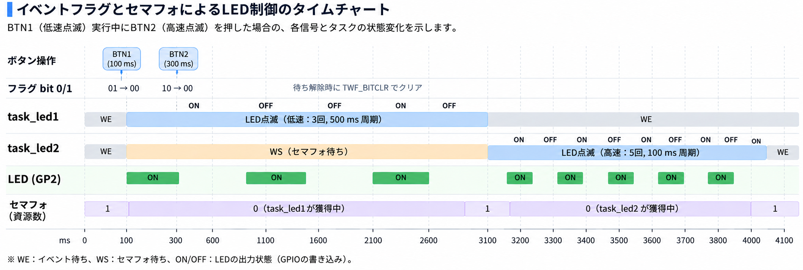

## はじめに

前回の記事「[Try Kernelのイベントフラグ — 複数の条件でタスクを同期する](https://zenn.dev/helowota/articles/pico-trykernel-event-flag)」では、ボタン操作をイベントフラグで通知し、2つのLED制御タスクを動かしました。

それぞれのタスクは異なる点滅パターンを持っています。しかし、両方のタスクが同じLEDを操作するため、点滅中にもう一方のボタンを押すと、LEDの点滅パターンが重なってしまいました。

タスク間で「処理を開始する条件」を伝えるだけでは、共有するハードウェアへのアクセスの競合は防げません。

今回は、Try Kernelの**セマフォ**を使って、複数のタスクが同じ資源を順番に使うための**排他制御**を学びます。

## 排他制御とは？

排他制御とは、複数のタスクが同じ資源を使用するとき、互いの処理が不適切に干渉しないように制御することです。

共有資源には、LEDのようなI/Oデバイスのほか、複数のタスクから読み書きするグローバル変数などがあります。

### LEDの取り合い

前回の[イベントフラグ編](https://zenn.dev/helowota/articles/pico-trykernel-event-flag#ledの操作が競合する)では、2つのタスクが1つのLEDを操作しました。

- タスク1：LEDを低速で3回点滅させる
- タスク2：LEDを高速で5回点滅させる

低速点滅の途中で高速点滅が始まると、両方のタスクが同じGPIOを操作するため、意図した点滅パターンが崩れてしまいます。

これを防ぐには、LEDを操作する権利を1つだけ用意し、使用中はもう一方のタスクに待ってもらえばよいわけです。

このように、共有資源を使用する処理が重ならないようにすることが排他制御です。

### グローバル変数も競合する

排他制御が必要なのは、LEDのようなI/Oデバイスだけではありません。

書籍P.92の図1では、共有するグローバル変数への演算が競合する例が紹介されています。

例えば、共有変数 `count` の初期値が0で、タスクAとタスクBがそれぞれ1を加算する場合を考えます。

```c
count++;
```

C言語では1行の処理ですが、実際には値の読み出し、加算、書き戻しという複数の処理が必要です。

その途中でタスクが切り替わると、両方のタスクが同じ値を読み出してしまい、2になるはずの `count` が1になってしまう場合があります。

このように、LEDなどのI/Oデバイスだけでなく、プログラム内の共有データについても排他制御が必要になります。

**排他制御を実現する代表的な仕組みの1つが、セマフォです。**

## セマフォとは？

セマフォは、利用可能な**資源の数**を管理するカーネルオブジェクトです。

タスクは共有資源を使う前にセマフォから資源を獲得し、使用後に返却します。必要な数の資源が残っていない場合は、獲得できるまで待ち状態になります。

今回は1つのLEDを排他制御するため、セマフォの初期資源数と最大資源数を1にします。

| 操作 | 資源数 | タスクの動作 |
|---|---:|---|
| 初期状態 | 1 | LEDは使用可能 |
| タスク1が獲得 | 0 | タスク1がLEDを使用 |
| タスク2が獲得を要求 | 0 | タスク2は待ち状態 |
| タスク1が返却 | 1 | 待っていたタスク2が獲得可能になる |
| タスク2が獲得 | 0 | タスク2がLEDを使用 |

※資源数は概念的な変化を示しています。待ちタスクがある場合の内部的な資源数の扱いは、OSの実装によって異なります。

### セマフォのwaitとsignal

セマフォの基本操作は、**wait**と**signal**です。

- **wait（獲得・待機）**：セマフォのカウンタが正なら減らして処理を続け、0なら待つ
- **signal（通知）**：セマフォのカウンタを増やす、または待っているタスクがあれば処理を再開できるようにする

signalは英語で「合図する」という意味です。タスク間の同期では、あるタスクが処理の完了を別のタスクに知らせるために使用します。

排他制御でも、資源を使い終わったことを知らせる操作として使用します。そのため、排他制御ではsignalを「資源の返却」と説明します。

つまり、**signalの本来の意味は「通知」であり、排他制御ではそれが「返却」に相当する**ということです。

Try Kernelでは、それぞれ `tk_wai_sem()` と `tk_sig_sem()` というAPIが用意されています。

## Try Kernelのセマフォ機能

書籍では第4部第3章（P.92〜96）で、セマフォの仕組みとAPIの実装を解説しています。ここではアプリケーションから使う基本APIに注目します。

| API | 機能 |
|---|---|
| `tk_cre_sem` | セマフォを生成する |
| `tk_wai_sem` | 指定した数の資源を獲得する。足りなければ待つ |
| `tk_sig_sem` | 指定した数の資源を返却する |

### セマフォを生成する：tk_cre_sem

```c
ID tk_cre_sem(const T_CSEM *pk_csem);
```

生成情報を設定した `T_CSEM` 構造体へのポインタを渡します。

```c
typedef struct t_csem {
    ATR sematr;   /* セマフォ属性 */
    INT isemcnt;  /* セマフォ初期値 */
    INT maxsem;   /* セマフォ最大値 */
} T_CSEM;
```

`isemcnt` は生成時の資源数、`maxsem` は保持できる最大資源数です。成功すると、以後の操作で使うセマフォIDを返します。

書籍には `TA_TFIFO`、`TA_FIRST` などのセマフォ属性が紹介されています。これらはIEEE 2050-2018規格に基づくものですが、Try Kernelは簡易実装のため、一部の属性には対応していません。

### 資源を獲得する：tk_wai_sem

```c
ER tk_wai_sem(ID semid, INT cnt, TMO tmout);
```

`semid` はセマフォID、`cnt` は要求する資源数、`tmout` は待ち時間です。

```c
tk_wai_sem(semid, 1, TMO_FEVR);
```

これは資源を1つ獲得する操作です。資源がなければ、`TMO_FEVR` の指定によって獲得できるまで待ち続けます。

### 資源を返却する：tk_sig_sem

```c
ER tk_sig_sem(ID semid, INT cnt);
```

```c
tk_sig_sem(semid, 1);
```

使用を終えた資源を1つ返却します。

`tk_sig_sem()` の内部では、OSがセマフォを待っているタスクを調べ、資源を獲得できる条件が整えば、そのタスクの待ち状態を解除します。

## セマフォによる排他制御の流れ

今回のサンプルでは、イベントフラグとセマフォを組み合わせます。

1. ボタン検出タスクが、押されたボタンに対応するイベントフラグをセットする。
2. LED制御タスクがイベントフラグ待ちから復帰する。
3. LED制御タスクがセマフォを獲得する。
4. LEDの点滅処理を実行する。
5. 点滅が終わったらセマフォを返却する。

一方のタスクがLEDを操作している間に、もう一方のタスクがLEDを操作しようとしても、セマフォによって排他制御されるため、点滅が重なることはありません。

### イベントフラグとの役割の違い

| 項目 | イベントフラグ | セマフォ |
|---|---|---|
| 主な役割 | イベント発生の通知と条件待ち | 資源数の管理と獲得待ち |
| 今回の用途 | BTN1・BTN2の押下を知らせる | LEDの使用権を1タスクに限定する |
| タスクが待つ条件 | 指定したビットがセットされること | 必要な資源数を獲得できること |

今回のプログラムでは、ボタンが押されるとイベントフラグによって対応するLED制御タスクに通知されます。

通知を受けたタスクはLEDの操作を開始しようとしますが、別のタスクがLEDを使用中であれば、セマフォの獲得待ちになります。

つまり、**イベントフラグは処理を始めるきっかけを伝え、セマフォは共有資源の競合を防ぐ**という役割を担っています。

## Try Kernelで実際に動かしてみる

書籍P.96のリスト8「セマフォ実験プログラムのタスク実行関数」に対応するサンプルを使います。

### 使用するコードと開発環境

ソースコードは、著者の[GitHubリポジトリ](https://github.com/ytoyoyama/interface_trykernel)をもとにしています。

- 使用するソースコード：`part_4/sect_3`
- サンプル・アプリケーション：`application/usermain.c`
- セマフォの実装：`kernel/semaphore.c`

| 項目 | 内容 |
|---|---|
| ターゲット | Raspberry Pi Pico W（RP2040）＋ Robo Pico Board |
| ホストOS | Windows 11 |
| ビルド | GNU Make、Arm GNU Toolchain |
| 書き込み・デバッグ | OpenOCD、GDB、CMSIS-DAP Debug Probe |
| UART確認 | Tera Term（115200 bps、8N1、フロー制御なし、受信改行LF） |
| 入力 | Robo Pico BoardのBTN1（GP20）、BTN2（GP21） |
| 出力 | Robo Pico BoardのLED（GP2） |

### 書籍からの変更点

書籍のGPIO割り当てとRobo Pico Boardの配線が異なるため、GPIO番号だけ変更しました。セマフォとイベントフラグの制御処理は変更していません。

| 用途 | 書籍掲載コード | Robo Pico Board |
|---|---|---|
| BTN1 | GP14 | GP20 |
| BTN2 | GP13 | GP21 |
| LED | GP25 | GP2 |

変更対象は `application/usermain.c` と `boot/reset_hdr.c` です。具体的な変更はAppendixにまとめます。

### サンプルコードの処理の流れ

**ボタン検出タスク**は100ms間隔でボタンを監視し、押下を検出すると対応するイベントフラグのビットをセットします。

**LED制御タスク1**はbit 0を待ち、セマフォを獲得すると500ms点灯・500ms消灯を3回繰り返します。

**LED制御タスク2**はbit 1を待ち、セマフォを獲得すると100ms点灯・100ms消灯を5回繰り返します。

どちらも点滅を終えるとセマフォを返却し、再びイベントフラグを待ちます。

### ビルドと実機への書き込み

Windows環境向けに `part_4/sect_3` にMakefileを用意しました。前回のイベントフラグ編のMakefileに `kernel/semaphore.c` を追加しています。

```makefile
TARGET := trykernel
CC := arm-none-eabi-gcc
SIZE := arm-none-eabi-size
OBJDUMP := arm-none-eabi-objdump

CFLAGS := -mcpu=cortex-m0plus -mthumb -O0 -ffreestanding -std=c99 -Iinclude -g
LDFLAGS := -mcpu=cortex-m0plus -mthumb -T linker/pico_memmap.ld -nostartfiles

SRCS := boot/boot2.c \
        boot/reset_hdr.c \
        boot/vector_tbl.c \
        kernel/syslib.c \
        kernel/context.c \
        kernel/inittsk.c \
        kernel/scheduler.c \
        kernel/systimer.c \
        kernel/task_mange.c \
        kernel/task_queue.c \
        kernel/task_sync.c \
        kernel/eventflag.c \
        kernel/semaphore.c \
        application/usermain.c

ASRCS := kernel/dispatch.S

OBJS := $(patsubst %.c,build/%.o,$(SRCS)) \
        $(patsubst %.S,build/%.o,$(ASRCS))

ELF := build/$(TARGET).elf

.PHONY: all clean size sections

all: $(ELF)

$(ELF): $(OBJS) linker/pico_memmap.ld
	$(CC) $(LDFLAGS) -o $@ $(OBJS)
	$(SIZE) $@

build/%.o: %.c
	@mkdir -p $(dir $@)
	$(CC) $(CFLAGS) -c $< -o $@

build/%.o: %.S
	@mkdir -p $(dir $@)
	$(CC) $(CFLAGS) -c $< -o $@

size: $(ELF)
	$(SIZE) $(ELF)

sections: $(ELF)
	$(OBJDUMP) -h $(ELF)

clean:
	rm -rf build
```

PowerShellでビルドします。

```powershell
make clean
make
make size
```

Robo Pico Board向けにGPIOを変更した後の実測結果は次のとおりです。

```text
arm-none-eabi-size build/trykernel.elf
   text    data     bss     dec     hex filename
   7514     100    5768   13382    3446 build/trykernel.elf
```

続いてPowerShellでOpenOCDを起動します。

```powershell
openocd -f interface/cmsis-dap.cfg -f target/rp2040.cfg
```

別のPowerShellからGDBを起動します。

```powershell
arm-none-eabi-gdb .\build\trykernel.elf
```

GDBから接続して書き込みます。

```text
target remote localhost:3333
monitor reset halt
load
monitor reset halt
```

Tera TermでUART受信を準備してから、GDBで実行します。

```text
continue
```

## 動作結果を確認する

今回は、BTN1を押すとLEDが低速で3回、BTN2を押すと高速で5回点滅します。

前回のイベントフラグ編では、一方の点滅中にもう一方のボタンを押すと、2つのタスクが同じLEDを操作して点滅パターンが崩れました。

今回はセマフォによってLEDの使用権を管理しています。**点滅中に別のボタンを押した場合、どのような動作になるでしょうか。**

### BTN1の点滅中にBTN2を押す

BTN1を押して低速点滅が始まった後、その点滅中にBTN2を押しました。

**実機では、BTN1による低速点滅が終了してから、BTN2による高速点滅が5回実行されることを確認しました。**

つまり、BTN2の押下は検出されますが、LEDが使用中のため、高速点滅は低速点滅の終了まで待たされます。

UART出力は次のとおりです。

```text
Strat Try Kernel
BTN-0 ON
BTN-1 ON
BTN-0 ON
BTN-1 ON
```

`Strat Try Kernel` はサンプルコードの出力をそのまま記録しています。`BTN-0 ON` と `BTN-1 ON` はボタンの押下検出を示します。

UARTログからはボタン検出順序が分かりますが、LEDの点滅順序は直接読み取れません。排他制御によって点滅が重ならなかったことは、**実機のLEDを観察して確認した結果**です。

## サンプルコードで使うセマフォ

### セマフォの生成

`application/usermain.c` では、セマフォ生成情報を次のように定義しています。

```c
/* セマフォ生成情報 */
ID  semid;
T_CSEM  csem = {
    .sematr     = TA_TFIFO | TA_FIRST,  // セマフォ属性
    .isemcnt    = 1,                    // セマフォ資源数の初期値
    .maxsem     = 1,                    // セマフォ資源数の最大値
};
```

`usermain()` では、この生成情報を使ってセマフォを生成します。

```c
/* セマフォの生成 */
semid = tk_cre_sem(&csem);
```

初期資源数と最大資源数をともに1にすることで、LEDを操作できるタスクを1つに制限します。

生成されたセマフォIDは `semid` に保存され、2つのLED制御タスクで共有されます。

### LED制御タスク1

BTN1が押されると、イベントフラグのビット0がセットされ、LED制御タスク1の待ち状態が解除されます。

```c
/* LED制御タスク1の実行関数 */
void task_led1(INT stacd, void *exinf)
{
    UINT flgptn;

    while(1) {
        tk_wai_flg(flgid, (1<<0), TWF_ANDW | TWF_BITCLR, &flgptn, TMO_FEVR);    // フラグ待ち

        tk_wai_sem(semid, 1, TMO_FEVR);     // 資源の獲得
        for(INT i = 0; i <3; i++) {
            out_w(GPIO_OUT_SET, (1<<2));   // LEDの点灯
            tk_dly_tsk(500);              // 0.5秒待ち
            out_w(GPIO_OUT_CLR, (1<<2));   // LEDの消灯
            tk_dly_tsk(500);              // 0.5秒待ち
        }
        tk_sig_sem(semid, 1);             // 資源の返却
    }
}
```

イベントフラグによって処理を開始した後、`tk_wai_sem()` でLEDの使用権を獲得します。

LEDを3回点滅させた後、`tk_sig_sem()` で使用権を返却します。**この2つのAPIで挟まれた部分が排他制御の対象**です。

### LED制御タスク2

BTN2が押されると、イベントフラグのビット1がセットされ、LED制御タスク2の待ち状態が解除されます。

```c
/* LED制御タスク2の実行関数 */
void task_led2(INT stacd, void *exinf)
{
    UINT flgptn;

    while(1) {
        tk_wai_flg(flgid, (1<<1), TWF_ANDW | TWF_BITCLR, &flgptn, TMO_FEVR);    // フラグ待ち

        tk_wai_sem(semid, 1, TMO_FEVR);     // 資源の獲得
        for(INT i = 0; i <5; i++) {
            out_w(GPIO_OUT_SET, (1<<2));   // LEDの点灯
            tk_dly_tsk(100);              // 0.1秒待ち
            out_w(GPIO_OUT_CLR, (1<<2));   // LEDの消灯
            tk_dly_tsk(100);              // 0.1秒待ち
        }
        tk_sig_sem(semid, 1);             // 資源の返却
    }
}
```

タスク1との違いは、待つイベントフラグのビットとLEDの点滅回数・周期です。

**どちらのタスクも同じセマフォを使用する**ため、一方がLEDを操作している間、もう一方はセマフォの獲得待ちになります。

## セマフォ待ちを含むタイムチャート



タイムチャートでは、イベントフラグ待ちとセマフォ待ちを区別して示しています。LED点滅中の `tk_dly_tsk()` による時間待ちは省略しています。

BTN1の点滅中にBTN2を押した場合、タスク2はイベントフラグ待ちから復帰しますが、セマフォを獲得できないため、セマフォ待ちになります。

タスク1が点滅を終えてセマフォを返却すると、タスク2が使用権を獲得し、高速点滅を開始します。

## 実機で動かして分かったこと

前回のイベントフラグ編と今回のセマフォ編では、ボタン入力とLED点滅の基本動作は同じです。

違うのは、**LED点滅の前後でセマフォの獲得と返却を行う**点です。

| 項目 | イベントフラグ編 | セマフォ編 |
|---|---|---|
| ボタン操作の通知 | イベントフラグ | イベントフラグ |
| LED使用前の獲得処理 | なし | `tk_wai_sem()` |
| LED使用後の返却処理 | なし | `tk_sig_sem()` |
| 点滅中に別ボタンを押した場合 | 点滅が重なった | 先の点滅終了後に次の点滅が始まった |

この比較によって、タスクを同期させることと、共有資源を排他的に使わせることは別の役割であると確認できました。

## おわりに

今回はTry Kernelのセマフォを使い、複数のタスクが共有するLEDを順番に操作する排他制御を確認しました。

前回のイベントフラグではタスク間の通知を実現しましたが、それだけでは共有資源へのアクセスの競合を防げませんでした。セマフォを追加することで、先に始まった点滅が終了するまで、次のタスクがLEDを操作しないようにできました。

書籍では、この第4部でTry Kernelの基本的なRTOS機能が一通り完成し、続く第5部でアプリケーションの作成に進みます。

## 参考資料

- CQ出版社『Interface』2023年7月号「ラズパイPicoで1500行 ゼロから作るOS」
  - 第4部 第2章「複数のタスク間で複雑な同期もできる…イベント・フラグ」
  - 第4部 第3章「複数のタスク間での資源競合を防ぐ…セマフォによる排他制御」
- [Try Kernel 著者公開ソースコード](https://github.com/ytoyoyama/interface_trykernel)
- [Try Kernelのタスク管理 — なぜOSが必要なのか？](https://zenn.dev/helowota/articles/pico-trykernel-task-management)
- [Try Kernelのタスク付属同期 — タスクを待たせる・起こす](https://zenn.dev/helowota/articles/pico-trykernel-task-sync)
- [Try Kernelのイベントフラグ — 複数の条件でタスクを同期する](https://zenn.dev/helowota/articles/pico-trykernel-event-flag)

---

## Appendix：Robo Pico Board向けGPIO設定

書籍のGPIO設定をRobo Pico Boardに合わせて変更しました。

| 用途 | 書籍掲載コード | Robo Pico Board |
|---|---|---|
| BTN1 | GP14 | GP20 |
| BTN2 | GP13 | GP21 |
| LED | GP25 | GP2 |

`application/usermain.c` のボタン入力の初期化、入力マスク、押下判定をGP20・GP21に変更しました。2つのLED制御タスクのLED出力をGP2に変更しました。

`boot/reset_hdr.c` のLED出力初期化もGP2に変更しました。

```c
out_w(GPIO_OE_CLR, (1<<2));
out_w(GPIO_OUT_CLR, (1<<2));
out_w(GPIO_CTRL(2), 5);
out_w(GPIO_OE_SET, (1<<2));
```

なお、今回の作業開始時点のローカルソースは、以前のブレッドボード実験のためLEDがGP15に変更されていました。記事の差分説明では、書籍掲載コードのGP25を基準としています。

イベントフラグのビット番号とセマフォの制御処理は変更していません。
