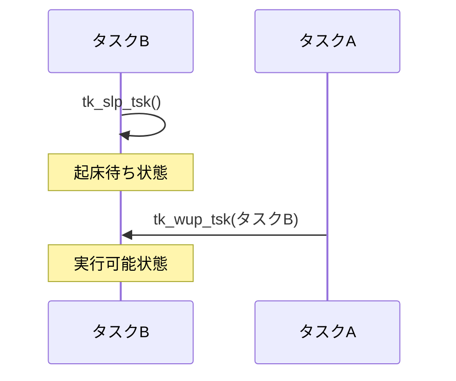
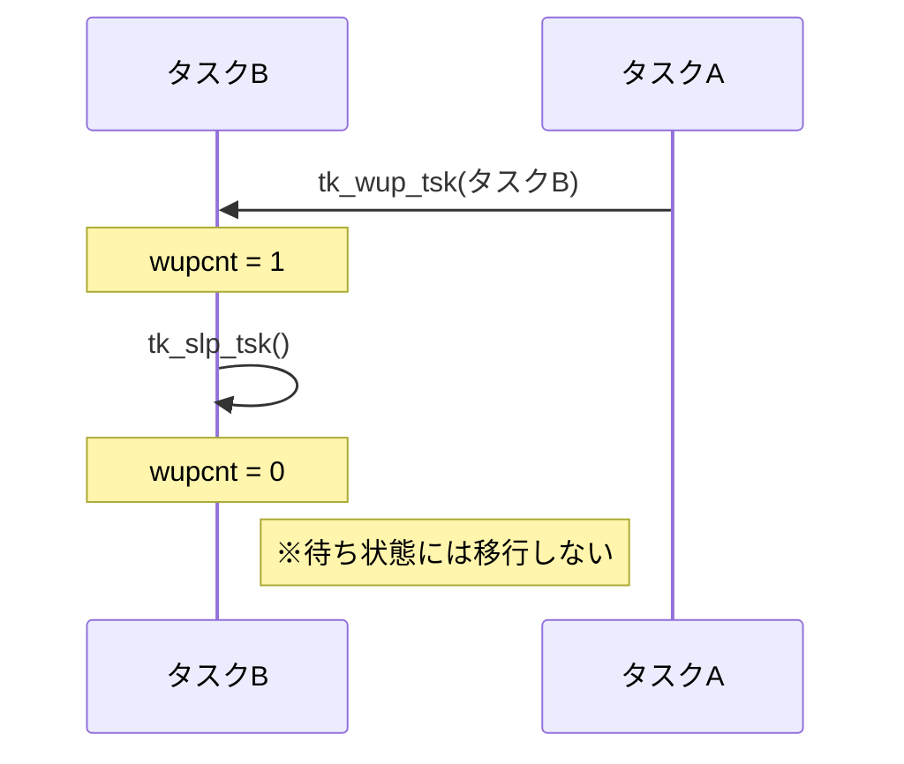
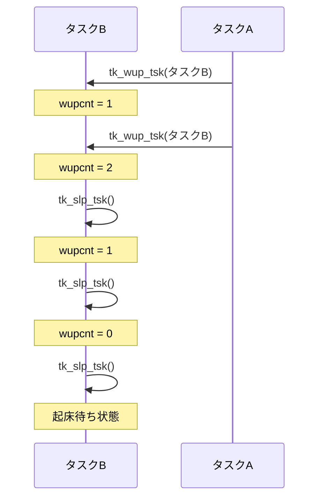

## はじめに

本記事は、CQ出版社『Interface』2023年7月号の特集「ラズパイPicoで1500行 ゼロから作るOS」で紹介されたリアルタイムOS「Try Kernel」を題材に、OSの仕組みを実機で学ぶシリーズの一部です。

前回の記事「[Try Kernelのタスク管理 — なぜOSが必要なのか？](https://zenn.dev/helowota/articles/pico-trykernel-task-management)」では、タスクの生成・起動・終了という一連の動作を確認しました。

前回の記事「[Try Kernelのタスク管理 — なぜOSが必要なのか？](https://zenn.dev/helowota/articles/pico-trykernel-task-management)」では、Try Kernelのタスク管理機能を使って、タスクの生成・起動・終了という一連の動作を確認しました。

マルチタスクOSを使うことで、複数の処理をタスクとして分離し、その実行をOSに管理させられます。

しかし、実際のアプリケーションでは、タスクを独立して動かすだけでなく、タスク同士の連携も必要になります。

例えば、センサからデータを取得するタスクと、そのデータを処理するタスクを考えてみます。

データ処理タスクは、新しいデータが取得されるまで待ち、データが用意されたタイミングで処理を開始します。

このように、**複数のタスクが互いの動作に合わせて処理を進めることを「タスクの同期」と呼びます。**

今回は、Try Kernelが提供する「タスク付属同期機能」を使って、タスクを待たせたり、起こしたりする仕組みを学びます。

## タスク付属同期とは？

前回のサンプルでは、タスク1とタスク2を生成・起動し、それぞれのタスクが文字列を出力して終了しました。

しかし、実際の組込みシステムでは、ある処理の結果を受けて、別の処理を開始するなど、タスク同士の連携が必要になる場合があります。

例えば、次の2つのタスクを考えてみます。

- タスクA：ボタンの入力を監視する
- タスクB：LEDを点灯させる

ボタンが押されたときにLEDを点灯させるには、タスクBがボタンの入力を待ち、タスクAからの通知を受けて処理を開始する仕組みが必要です。

単純な方法として、共有変数を繰り返し確認する方法があります。

```c
while (button_pressed == 0) {
    /* ボタンが押されるまで待つ */
}
```
このように、`while` や `for` などのループで条件を繰り返し確認する処理をビジーウェイトと呼び、待機中もCPUを使い続けます。

マルチタスクOSでは、タスクを待ち状態にすることで、**待機中のタスクはCPUを使わず、その間にほかのタスクを実行できます。**

その方法の一つが、**タスク付属同期**です。

タスク付属同期とは、タスク自身に備わった同期機能を利用して、タスクを待たせたり、別のタスクから起こしたりする仕組みです。

**「付属」という名前のとおり、セマフォやイベントフラグのような独立した同期オブジェクトを使わず、タスク自身の機能だけでも同期を取ることができます。**

セマフォやイベントフラグについては、次回以降の記事で改めて取り上げます。

---

## Try Kernelのタスク付属同期機能

書籍では、第4部 第1章（P.80〜）でタスク付属同期機能の仕組みを解説しています。ここでは、その機能をアプリケーションから使う側に注目します。

Try Kernelでは、タスク付属同期機能として、タスクの起床待ちと起床要求を行うAPIが用意されています。

タスク付属同期には、次の2つのAPIを使用します。

| API | 機能 |
|---|---|
| `tk_slp_tsk` | 自タスクを起床待ち状態にする |
| `tk_wup_tsk` | 指定したタスクに起床要求を送る |

### タスクを起床待ちにする：tk_slp_tsk

```c
ER tk_slp_tsk(TMO tmout);
```

現在実行中のタスク自身を起床待ちにするAPIです。

`tmout` には、起床を待つ時間をミリ秒単位で指定します。

`tmout` に `TMO_FEVR` を指定すると、タイムアウトを設けずに起床要求を待ちます。

起床要求がまだ届いていない場合、このAPIを呼び出したタスクは実行状態から「待ち状態」になります。

待ち状態になったタスクにはCPUが割り当てられず、OSはほかの実行可能なタスクを選択します。

一方、すでに起床要求が届いている場合は、待ち状態にならずに処理を継続します。

また、指定した時間内に起床要求が届かなかった場合は、タイムアウトによって待ち状態が解除され、`E_TMOUT` が返されます。

### タスクを起こす：tk_wup_tsk

```c
ER tk_wup_tsk(ID tskid);
```

指定したタスクに起床要求を送るAPIです。

`tskid` には、起床させたいタスクのIDを指定します。

対象のタスクが `tk_slp_tsk()` によって起床待ち状態になっている場合、待ち状態を解除して実行可能状態にします。

ただし、**起床要求を送ったからといって、そのタスクが直ちにCPUで実行されるとは限りません。**

実際にどのタスクが実行されるかは、前回学んだスケジューリングによって決まります。

また、対象のタスクがまだ起床待ち状態になっていない場合でも、起床要求は失われず、OSの内部に保持されます。

Try Kernelでは、タスク制御ブロック（TCB）の `wupcnt` に、起床要求の回数として保持されます。

この仕組みが、タスクの同期では重要になります。

## 起床待ちと起床要求の順序

`tk_slp_tsk()` と `tk_wup_tsk()` は、組み合わせて使用するAPIです。

複数のタスクは独立して動いているため、起床待ちと起床要求の順序は必ずしも一定ではありません。

書籍では、APIの呼び出し順序や起床要求の回数によって、3つのケースを説明しています。

### 1. 起床待ちの後に起床要求が届く

まずタスクBが `tk_slp_tsk()` を呼び出し、起床待ち状態になります。

その後、タスクAが `tk_wup_tsk()` を呼び出します。



これは最も分かりやすいケースです。

タスクBは起床要求を受けると実行可能状態になり、スケジューリングによってCPUが割り当てられると処理を再開します。

### 2. 起床要求が先に届く

今度は、タスクAが先に `tk_wup_tsk()` を呼び出した場合です。

この時点では、タスクBはまだ起床待ち状態になっていません。



もし起床要求がそのまま捨てられてしまうと、タスクBは後から `tk_slp_tsk()` を呼び出したときに、起床要求を待ち続けることになります。

そこでTry Kernelは、**起床要求が先に届いた場合、その要求を保持します。**

タスクBが後から `tk_slp_tsk()` を呼び出すと、保持されていた起床要求を消費し、待ち状態にならずに処理を継続します。

### 3. 起床要求が複数回届く

さらに、タスクAが起床要求を2回送った後で、タスクBが起床待ちを行う場合を考えます。



Try Kernelでは、起床要求の回数をOS内部でカウントしています。

例えば、起床要求が2回保持されていれば、タスクBは `tk_slp_tsk()` を2回呼び出しても待ち状態になりません。

3回目の呼び出しで、保持されている起床要求がなくなっていれば、初めて起床待ち状態になります。

Try Kernelでは、タスク制御ブロック（TCB）の `wupcnt` で起床要求の回数を管理することで、APIの呼び出し順序が異なっても同期を取れるようになっています。

---

## タスクの状態遷移を整理する

[前回の記事](https://zenn.dev/helowota/articles/pico-trykernel-task-management)では、タスクの生成・起動・終了に注目しました。

今回は、新たに「待ち状態」が登場します。

```text
             tk_sta_tsk()
休止状態 ----------------------> 実行可能状態
                                     |
                                     | CPUが割り当てられる
                                     v
                                  実行状態
                                     |
                                     | tk_slp_tsk()
                                     v
                                  待ち状態
                                     |
                                     | tk_wup_tsk()
                                     v
                                実行可能状態
```

これは、起床要求がまだ保持されていない場合の簡略図です。

待ち状態になったタスクは、CPUを使わずに起床要求を待ちます。

別のタスクから `tk_wup_tsk()` が呼ばれると、実行可能状態に戻ります。

また、`tk_slp_tsk()` にタイムアウト時間を指定した場合は、起床要求がなくても指定時間の経過によって待ち状態が解除されます。

ここで重要なのは、**待ち状態の解除と、CPUで実際に実行されることは別**という点です。

これは[前回のタスク管理](https://zenn.dev/helowota/articles/pico-trykernel-task-management#実機で動かして分かったこと)で学んだ、実行可能状態と実行状態の違いにもつながります。

---

## Try Kernelで実際に動かしてみる

ここからは、書籍P.84のリスト6「タスク同期実験プログラムのタスク実行関数」に対応する著者公開のソースコードを使って、タスク付属同期機能の動作を確認します。

今回のサンプルでは、ボタン検出タスクとLED制御タスクを使います。

### 使用するコードと開発環境

ソースコードは、著者の[GitHubリポジトリ](https://github.com/ytoyoyama/interface_trykernel)で公開されています。

- 使用するソースコード：`part_4/sect_1`
- サンプル・アプリケーション：`application/usermain.c`

開発環境は、[前回の記事](https://zenn.dev/helowota/articles/pico-trykernel-task-management)と同じWindows 11上の環境を使用します。

| 項目 | 内容 |
|---|---|
| ターゲット | Raspberry Pi Pico W（RP2040）＋ Robo Pico |
| ビルド | GNU Make、Arm GNU Toolchain |
| 書き込み | OpenOCD、GDB |
| UART出力の確認 | Tera Term（115200 bps、8N1、フロー制御なし、受信改行LF） |
| デバッグプローブ | Pico互換ボード（CMSIS-DAP、UART） |
| 入力 | Robo Picoの押しボタン（GP20） |
| 出力 | Robo PicoのGrove 2にあるステータスLED（GP2） |

書籍のサンプルでは、GP14に接続した押しボタンとGP15のLEDを使用します。

今回は、Raspberry Pi Pico WをRobo Picoという拡張ボードに取り付けて使用しているため、ボタン入力をGP20、LED出力をGP2に変更し、Robo Pico上の押しボタンとステータスLEDを利用しました。

GPIOの変更箇所と具体的なコードは、記事末尾のAppendixにまとめています。

### サンプルコードの処理の流れ

今回のアプリケーションでは、2つのタスクが連携して動作します。

**1. ボタン検出タスクを動かす**

ボタン検出タスクは、GP20の入力状態を周期的に確認します。

ボタンが押されたことを検出すると、LED制御タスクに対して `tk_wup_tsk()` で起床要求を送ります。

入力の確認後は、`tk_dly_tsk(100)` によって0.1秒待ちます。

**2. LED制御タスクを待ち状態にする**

LED制御タスクは、`tk_slp_tsk(TMO_FEVR)` を呼び出して起床要求を待ちます。

起床要求が届くまでは、LEDの点灯処理を行いません。

**3. 起床要求を受けてLEDを点灯する**

ボタン検出タスクから起床要求を受けると、LED制御タスクは実行可能状態になります。

CPUが割り当てられると、LEDを点灯し、`tk_dly_tsk(1000)` によって1秒待った後、LEDを消灯します。

**4. 再び起床要求を待つ**

LED制御タスクは、再び `tk_slp_tsk(TMO_FEVR)` を呼び出します。

LEDの点灯中に追加の起床要求が届いていれば、その要求が保持されているため、次の点灯処理に進みます。

書籍では、ボタンを押した回数に応じてLEDの点灯時間が延長される動作を確認します。

### 実機で確認すること

Robo Pico上の押しボタンとステータスLEDを使用して、タスク付属同期の動作を確認します。

今回は、次の動作を確認します。

1. GP20の押しボタンを押すと、UARTに `BTN ON` が出力される
2. ボタン操作に応じて、Grove 2のステータスLED（GP2）が約1秒間点灯する
3. LEDが消灯する前にボタンを5回連続で押すと、UARTに `BTN ON` が5回出力され、LEDが約5秒間連続点灯しているように見える

また、ソースコードと実行結果を照らし合わせ、**LED制御タスクの処理中に届いた起床要求が保持され、順次処理される仕組み**を確認します。

### ビルドと実機での動作確認

著者のソースコード `part_4/sect_1` に、Windows環境でビルドするためのMakefileを追加します。また、Robo Picoに合わせてGPIOの割り当てを変更します。変更箇所は記事末尾のAppendixを参照してください。

`part_4/sect_1` ディレクトリに、以下の内容で `Makefile` を作成してください。

このMakefileは、前回の記事で構築した開発環境を前提としており、mkdir や rm などのコマンドを使用します。

```makefile
# Try Kernel - Part 4, Section 1 (RP2040)

TARGET := trykernel
CC := arm-none-eabi-gcc
SIZE := arm-none-eabi-size
OBJDUMP := arm-none-eabi-objdump

CFLAGS := -mcpu=cortex-m0plus -mthumb -O0 -ffreestanding -std=c99 -Iinclude -g
LDFLAGS := -mcpu=cortex-m0plus -mthumb -T linker/pico_memmap.ld -nostartfiles

SRCS := boot/boot2.c \
        boot/reset_hdr.c \
        boot/vector_tbl.c \
        kernel/syslib.c \
        kernel/context.c \
        kernel/inittsk.c \
        kernel/scheduler.c \
        kernel/systimer.c \
        kernel/task_mange.c \
        kernel/task_queue.c \
        kernel/task_sync.c \
        application/usermain.c

ASRCS := kernel/dispatch.S

OBJS := $(patsubst %.c,build/%.o,$(SRCS)) \
        $(patsubst %.S,build/%.o,$(ASRCS))

ELF := build/$(TARGET).elf

.PHONY: all clean size sections

all: $(ELF)

$(ELF): $(OBJS) linker/pico_memmap.ld
	$(CC) $(LDFLAGS) -o $@ $(OBJS)
	$(SIZE) $@

build/%.o: %.c
	@mkdir -p $(dir $@)
	$(CC) $(CFLAGS) -c $< -o $@

build/%.o: %.S
	@mkdir -p $(dir $@)
	$(CC) $(CFLAGS) -c $< -o $@

size: $(ELF)
	$(SIZE) $(ELF)

sections: $(ELF)
	$(OBJDUMP) -h $(ELF)

clean:
	rm -rf build
```

:::message
Makefileのコマンド行は、行頭をスペースではなくタブにしてください。
:::

PowerShellで `part_4/sect_1` に移動し、以下を実行します。

```powershell
make clean
make
```

正常にビルドできると、`build/trykernel.elf` が生成されます。

今回の環境では、次の結果になりました。

```text
   text    data     bss     dec     hex filename
   5396      60    3932    9388    24ac build/trykernel.elf
```

続いて、Debug Probeを接続し、OpenOCDを起動します。

```powershell
openocd -f interface/cmsis-dap.cfg -f target/rp2040.cfg
```

別のPowerShellからGDBを起動します。

```powershell
arm-none-eabi-gdb .\build\trykernel.elf
```

GDBで以下を実行し、プログラムを書き込みます。

```text
target remote localhost:3333
monitor reset halt
load
monitor reset halt
```

書き込み後、UART出力を受信できる状態にしてから、GDBでプログラムを実行します。

```text
continue
```

実行結果は、次の「動作結果を確認する」で紹介します。

### 動作結果を確認する

Try Kernelの起動メッセージやボタン操作による文字列出力は、Debug ProbeのUART経由で確認します。

Tera Termを起動し、Debug Probeのシリアルポートを選択します。通信条件は前記事と同じ115200 bps、8 bit、パリティなし、ストップビット1 bit、フロー制御なし、受信改行コードLFです。

プログラムを実行すると、UARTに次の起動メッセージが表示されます。

```text
Strat Try Kernel
```

Robo PicoのGP20に接続された押しボタンを押すと、次のメッセージが出力されます。

```text
BTN ON
```

同時に、Grove 2のステータスLED（GP2）が約1秒間点灯し、その後消灯します。

さらに、ボタンを5回連続で押すと、UARTには次のように出力されます。

```text
BTN ON
BTN ON
BTN ON
BTN ON
BTN ON
```

LEDは約5秒間連続して点灯しているように見えます。

ソースコード上は、LEDを1秒間点灯した後に一度消灯し、保持された起床要求があれば直ちに再点灯します。そのため、目視では消灯と再点灯の境界を確認できません。

### 実機で動かして分かったこと

今回注目したいのは、**LED制御タスクが処理中でも、ボタン検出タスクから起床要求を送れる**という点です。

ボタン検出タスクは、ボタンが押されると `tk_wup_tsk()` を呼び出し、LED制御タスクに起床要求を送ります。

LED制御タスクは、`tk_slp_tsk()` で起床要求を待ち、要求を受けるとLEDを点灯して1秒後に消灯します。

ここで、LED制御タスクが1秒間の遅延処理を行っている間に追加の起床要求が届くと、Try Kernelはその回数を `wupcnt` に保持します。

LED制御タスクが次の `tk_slp_tsk()` を呼び出したとき、起床要求が残っていれば待ち状態に移行せず、次のLED点灯処理を開始します。

つまり、**起床要求が先に届いても失われず、後から `tk_slp_tsk()` を呼び出したときに処理できる**ことが、今回の重要なポイントです。

5回連続でボタンを押したときのLEDの動作も、この仕組みと整合しています。

---

## おわりに

今回は、Try Kernelのタスク付属同期機能について、タスクの起床待ちと起床要求の仕組みを整理し、実機で動作を確認しました。

マルチタスクOSでは、複数のタスクを独立して動かすだけでなく、必要なタイミングで連携させることも重要です。

`tk_slp_tsk()` と `tk_wup_tsk()` を使うことで、タスクを待ち状態にしたり、別のタスクから起床させたりできます。また、起床要求が先に届いた場合でも、その回数が保持されることを学びました。

次回は、複数の条件を使ったタスク間の同期を実現する**イベントフラグ**を取り上げます。

## 参考資料

- CQ出版社『Interface』2023年7月号「ラズパイPicoで1500行 ゼロから作るOS」
  - 第3部：タスク管理機能とシステム・タイマ
  - 第4部 第1章「主に1対1のタスク同期に使われる…起床待ちと起床」
- [Try Kernel 著者公開ソースコード](https://github.com/ytoyoyama/interface_trykernel)
- [Try Kernelのタスク管理 — なぜOSが必要なのか？](https://zenn.dev/helowota/articles/pico-trykernel-task-management)

---

## Appendix：Robo Pico向けのGPIO設定

今回の実験では、Robo Pico上の押しボタン（GP20）と、Grove 2のステータスLED（GP2）を使用しました。

書籍のサンプルコードから変更した箇所を示します。

### `application/usermain.c`

ボタン検出タスクのGPIO設定と入力処理を、GP14からGP20に変更します。

```c
/* GP20をスイッチ入力に設定 (Robo Pico) */
out_w(GPIO(20), (in_w(GPIO(20)) | GPIO_PUE) & ~GPIO_PDE);
out_w(GPIO_OE_CLR, (1<<20));
out_w(GPIO_CTRL(20), 5);

btn0 = in_w(GPIO_IN) & (1<<20);
```

`while(1)` 内のボタン入力も変更します。

```c
btn = in_w(GPIO_IN) & (1<<20);
```

LED制御タスクでは、出力先をGP15からGP2に変更します。

```c
out_w(GPIO_OUT_SET, (1<<2));    /* LED点灯 */
tk_dly_tsk(1000);               /* 1秒待ち */
out_w(GPIO_OUT_CLR, (1<<2));    /* LED消灯 */
```

### `boot/reset_hdr.c`

LED用GPIOの初期化をGP15からGP2に変更します。

```c
/* GP2をLED出力に設定 (Robo Pico) */
out_w(GPIO_OE_CLR, (1<<2));    /* GP2出力無効 */
out_w(GPIO_OUT_CLR, (1<<2));   /* GP2出力クリア */
out_w(GPIO_CTRL(2), 5);        /* GP2をSIO機能に設定 */
out_w(GPIO_OE_SET, (1<<2));    /* GP2出力有効 */
```

変更したのはGPIOの割り当てのみです。Try Kernelのタスク付属同期機能やタスクの処理手順は変更していません。
