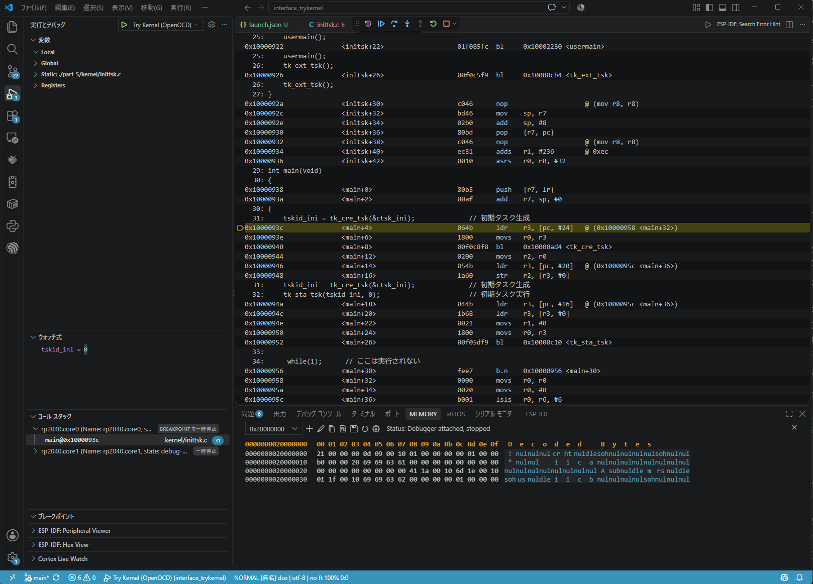
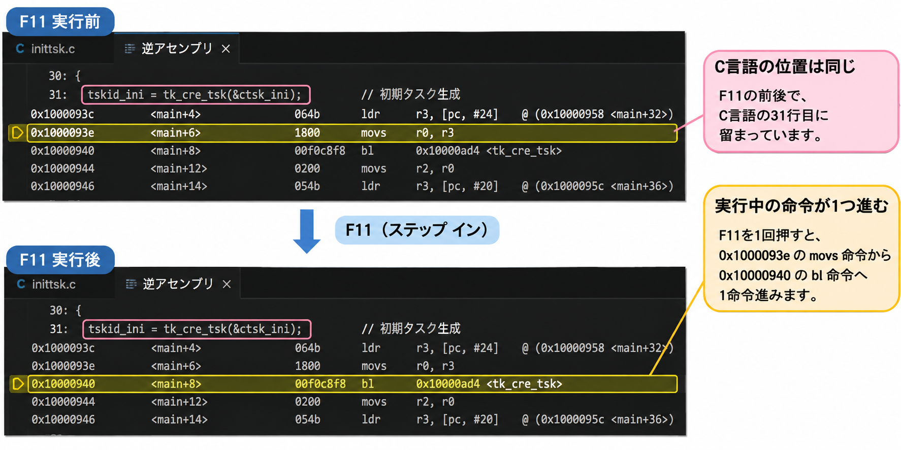
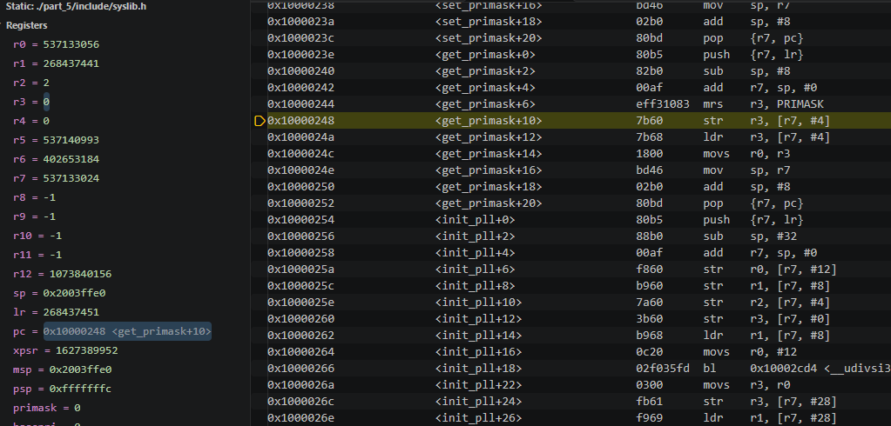
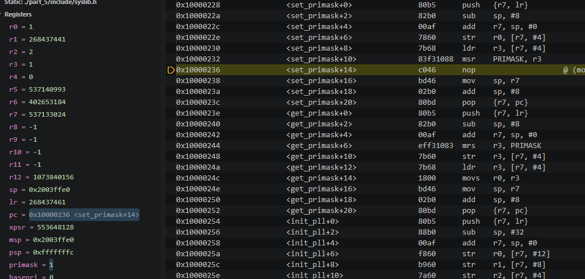

# はじめに

Interface 2023年7月号『ラズパイPicoで1500行 ゼロから作るOS』では、開発環境としてEclipseが使用されています。

同誌38ページの「開発環境の構築」では、著者も当初はVSCodeで開発を始めたものの、デバッグの過程でEclipseの機能が必要になったと説明されています。その具体例が、**アセンブリ言語レベルのステップ実行**です。

これまでの記事では、VSCodeのCortex-Debugを使い、Try Kernelのブレークポイント、C言語のステップ実行、変数監視、メモリ表示を確認しました。

今回はもう一歩進めて、**逆アセンブル表示とアセンブリ命令単位のステップ実行**を試します。

## 前提となる環境

前回の記事と同じ環境を使用します。

- Windows 11
- Raspberry Pi Pico W（RP2040）
- CMSIS-DAP対応デバッグプローブ
- OpenOCD
- Arm GNU Toolchain（`arm-none-eabi-gdb`）
- VSCode + Cortex-Debug
- Try Kernel（`part_5`）

VSCodeからOpenOCDとGDBを起動し、`main` 関数で停止できる状態を前提とします。

環境構築と基本的なデバッグ操作については、前回の記事を参照してください。

- [VSCodeとOpenOCD/GDBでRaspberry Pi Picoをデバッグする](https://zenn.dev/helowota/articles/pico-vscode-cortex-debug)

---

# 逆アセンブル表示を開く

VSCodeでTry Kernelのワークスペースを開き、`F5` でデバッグを開始します。

`launch.json` の `runToEntryPoint` に `main` を指定しているため、まず `kernel/inittsk.c` の `main` 関数で停止します。

`main()` で停止した状態で、`Ctrl + Shift + P` からコマンドパレットを開き、`Open Disassembly View`（逆アセンブリ ビューを開く）を実行します。

逆アセンブリ ビューには、CPUが実行する命令とそのアドレスが表示されます。



C言語のソースコードでは1行に見える処理も、CPU上では複数の命令として実行されます。逆アセンブル表示では、実行する命令とそのアドレスを確認できます。

---

# アセンブリ命令単位でステップ実行する

逆アセンブリ ビューでは、`F11`（Step Into）と `F10`（Step Over）を使って、アセンブリ命令単位でステップ実行できます。

実際に `main()` の31行目にある、初期タスクを生成する処理を追ってみます。

```c
tskid_ini = tk_cre_tsk(&ctsk_ini);
```

`F11` を押すと、実行位置が次のように変化しました。

| アドレス | 命令 |
|---|---|
| `0x1000093e` | `movs r0, r3` |
| `0x10000940` | `bl 0x10000ad4 <tk_cre_tsk>` |



C言語のソースコードでは同じ31行目のままですが、CPU命令は1命令進んでいます。

また、`F10` と `F11` は、関数呼び出しの `bl` 命令で動作が異なります。

| 操作 | 動作 |
|---|---|
| `F11`（Step Into） | 呼び出し先の関数に入る |
| `F10`（Step Over） | 呼び出し先の関数を実行し、戻り先の命令で停止する |

実際に `0x10000940` の `bl` 命令で `F10` を押すと、`tk_cre_tsk()` の実行後、次の `0x10000944` の命令で停止しました。

このように、C言語の1行を構成する命令を確認したり、関数呼び出しを命令単位で追ったりできます。

なお、RP2040のCortex-M0+が実行するThumb命令には16ビット命令と32ビット命令があります。今回の `movs` 命令は16ビットなので、次の命令アドレスは2バイト先になっています。

---

# スタートアップ処理を追う

次は、`main()` に到達する前のスタートアップ処理を確認します。

『Interface 2023年7月号』139〜140ページでは、ブート・プログラムとスタートアップ・コードが解説されています。こうした処理は、アセンブリ命令単位のデバッグが役立つ場面の一つです。

今回は、`part_5/boot/reset_hdr.c` の `Reset_Handler()` にある、割り込み無効化処理を追ってみます。

`DI(intsts)` にブレークポイントを設定すると、`launch.json` を変更することなく、`main()` より前で停止できました。

逆アセンブリ ビューから `F11` でステップ実行し、`get_primask()` の内部に入ると、次の命令が確認できました。

```asm
0x10000244  mrs r3, PRIMASK
```

これは、割り込みマスクの状態を表すPRIMASKレジスタを、汎用レジスタ `r3` に読み出す命令です。

この命令を実行すると、PCは `0x10000248` に進み、`r3` にPRIMASKの値である `0` が読み出されました。



VSCodeのRegisters表示では、**値が変化したレジスタがハイライトされる**ため、命令の実行によってどのレジスタが更新されたかも確認できます。

この時点ではPRIMASKは `0` であり、割り込みはまだ無効化されていません。

続いて、`set_primask()` に入り、割り込みを無効化する処理を確認します。

```asm
0x10000232  msr PRIMASK, r3
```

この命令は、汎用レジスタ `r3` の値をPRIMASKレジスタへ書き込みます。

`F11` で命令を実行すると、PRIMASKが `0` から `1` に変化し、Registers表示でも値の変化がハイライトされました。



このように、**C言語では `DI(intsts)` の1行で表現されている処理を、CPU命令とレジスタの変化を確認しながら追うことができます。**

---

# ほかにどんな場面で役立つか

アセンブリ命令単位のデバッグは、タスク切り替え処理の解析にも役立ちます。

『Interface 2023年7月号』第3部 ステップ2、第1章「プログラムを切り替えるディスパッチャ」（60〜64ページ）では、PendSV例外を利用した簡易ディスパッチャが解説されています。

64ページのリスト4には、CPUレジスタの退避・復元やスタックポインタの切り替えを行うアセンブリコードが掲載されています。

こうした処理も、命令単位でステップ実行すれば、レジスタやスタックの変化を確認しながら動作を理解できます。

今回はタスク切り替えまでは追いませんでしたが、OSの内部動作を調べる際にも活用できそうです。

---

# おわりに

VSCode/Cortex-Debugを使い、Raspberry Pi Pico上でアセンブリ命令単位のデバッグを試しました。

逆アセンブリ表示から `F10` / `F11` で命令単位のステップ実行ができ、`Reset_Handler()` ではPRIMASKレジスタの読み出しと書き込みを確認できました。

また、Registers表示では値が変化したレジスタがハイライトされ、命令の実行結果を視覚的に確認できました。

**書籍でEclipseを使用する理由の一つとして挙げられていたアセンブリ命令単位のデバッグは、今回の環境ではVSCode/Cortex-Debugでも実現できました。**
