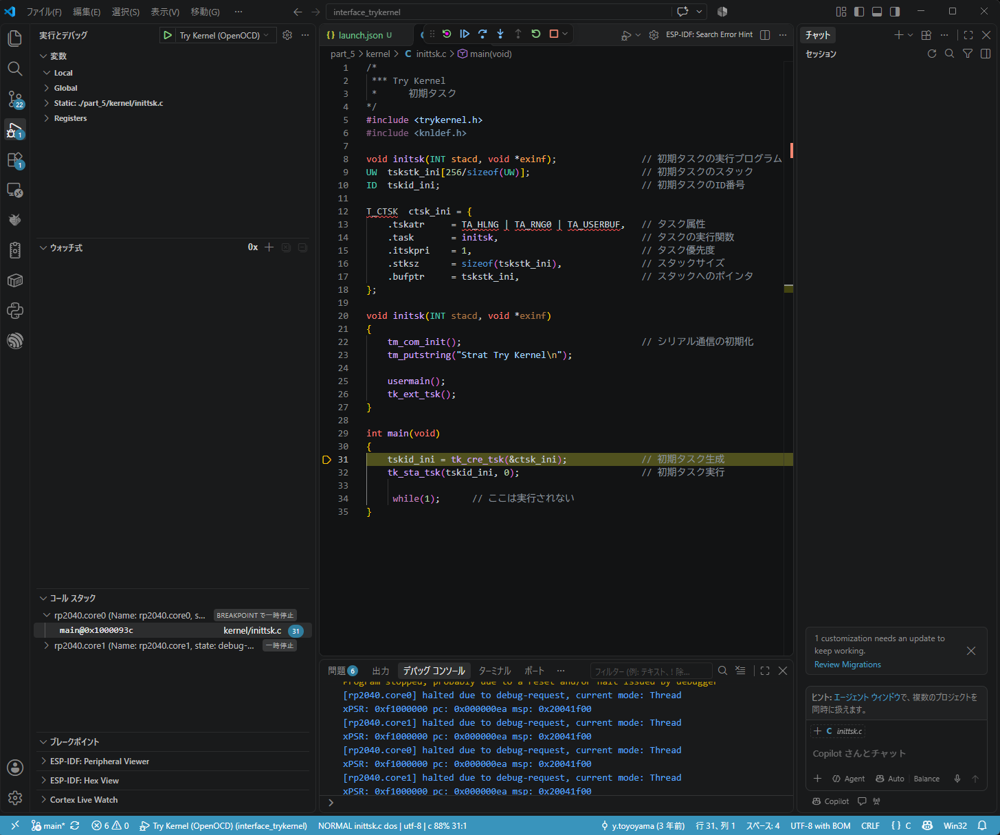
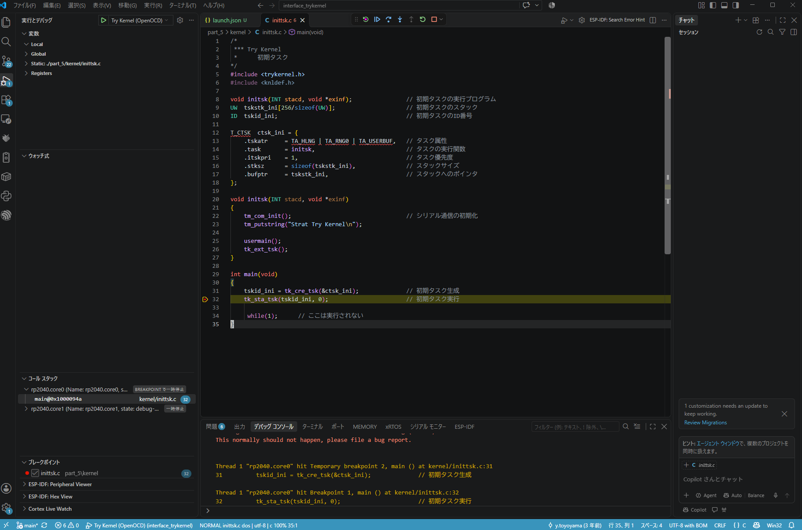
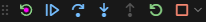
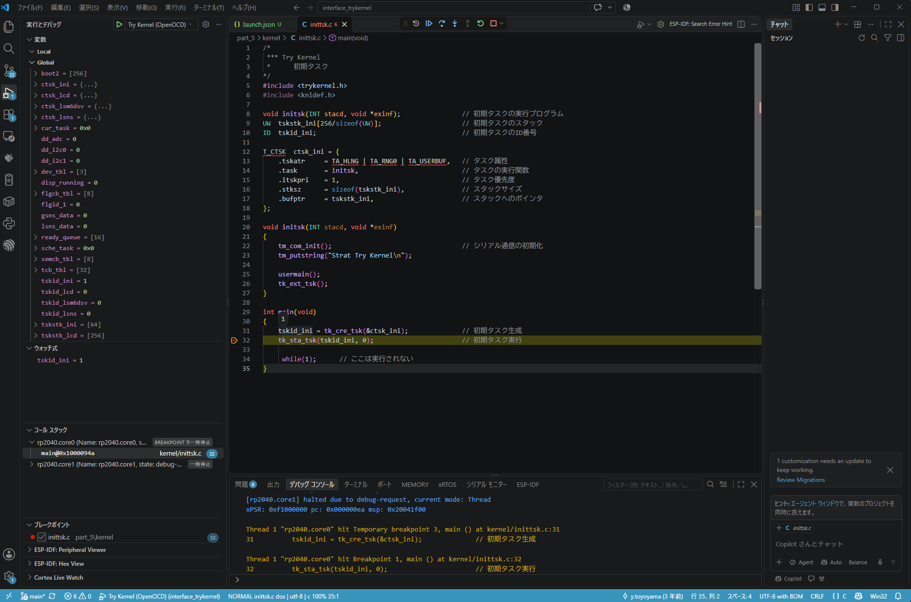
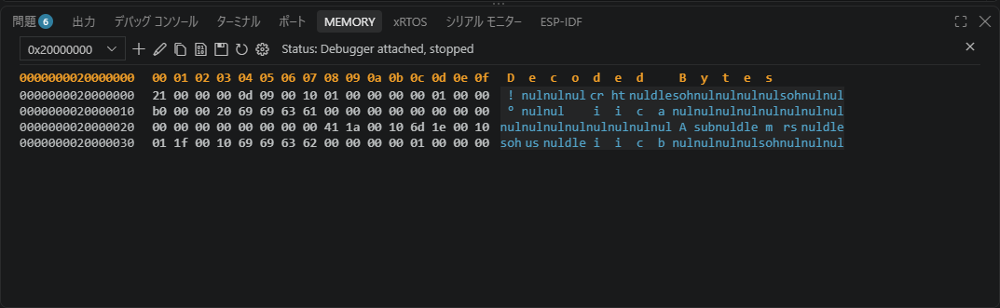

# はじめに

これまでの記事では、Windows 11上にTry Kernelの開発環境を構築し、OpenOCDとGDBを使ってRaspberry Pi Pico Wの実機デバッグを行いました。

また、Vim 9の標準機能である `termdebug` を使い、GVimからソースコードと連動したデバッグも行いました。

今回は、Visual Studio Code（VSCode）の拡張機能 **Cortex-Debug** を使って、同じTry Kernelをデバッグします。

Cortex-Debugを使用すると、OpenOCD・GDBの起動を自動化し、ブレークポイントの設定やステップ実行、変数の監視などをVSCode上で操作できます。

内部ではこれまでと同じOpenOCDとGDBを使用していますが、それらの起動や接続もCortex-Debugに任せることができます。

## 前提となる環境

今回使用する環境は、これまでの記事と同じです。

- Windows 11
- Raspberry Pi Pico W（RP2040）
- CMSIS-DAP対応デバッグプローブ
- OpenOCD
- Arm GNU Toolchain（`arm-none-eabi-gdb`）
- Try Kernel（`part_5`）

Try Kernelはビルド済みで、デバッグ情報を含む `trykernel.elf` が生成されているものとします。

開発環境の構築やOpenOCD/GDBの基本操作については、以下の記事を参照してください。

- [「ラズパイPicoで1500行 ゼロから作るOS」を2026年に動かす](https://zenn.dev/helowota/articles/pico-trykernel-windows-env)
- [OpenOCDとGDBでRaspberry Pi Picoをデバッグする](https://zenn.dev/helowota/articles/pico-openocd-gdb-debug)

また、Vimでデバッグする場合は、[Vim 9のtermdebugでRaspberry Pi Picoをデバッグする](https://zenn.dev/helowota/articles/pico-vim9-termdebug) を参照してください。同じ環境を使用しているため、VSCodeとの操作の違いも比較できます。

---

# Cortex-Debugを導入する

VSCodeに拡張機能「Cortex-Debug」をインストールします。

Cortex-Debugは、Arm Cortex-M向けのデバッグ拡張機能で、OpenOCDとGDBを使用した実機デバッグをVSCodeから操作できるようにします。

VSCodeの拡張機能画面（`Ctrl+Shift+X`）で `Cortex-Debug` を検索し、インストールします。

# デバッグ構成を設定する

## OpenOCDとGDBの役割

今回のデバッグ環境は、概念的には次の構成です。

```text
VSCode
  └─ Cortex-Debug
       └─ GDB（arm-none-eabi-gdb）
            └─ GDB Remote Protocol
                 └─ OpenOCD
                      └─ CMSIS-DAP
                           └─ SWD
                                └─ Raspberry Pi Pico W
```

Cortex-DebugがGDBとOpenOCDの起動・接続を管理します。

これまで手動で起動・接続していたGDBとOpenOCDを、今回はCortex-Debugが自動的に起動・接続します。

## launch.jsonを作成する

VSCodeでは、ワークスペース固有の設定を `.vscode` フォルダに保存します。デバッグの設定には `launch.json` というファイルを使用します。

今回は、Cortex-DebugがOpenOCDとGDBを起動・接続する構成を設定します。

VSCodeで `interface_trykernel` フォルダを開き、`.vscode/launch.json` を作成します。

```json
{
    "version": "0.2.0",
    "configurations": [
        {
            "name": "Try Kernel (OpenOCD)",
            "type": "cortex-debug",
            "request": "launch",
            "servertype": "openocd",
            "cwd": "${workspaceFolder}",
            "executable": "${workspaceFolder}/part_5/build/trykernel.elf",
            "gdbPath": "arm-none-eabi-gdb",
            "device": "RP2040",
            "interface": "swd",
            "configFiles": [
                "interface/cmsis-dap.cfg",
                "target/rp2040.cfg"
            ],
            "serverArgs": [
                "-c",
                "adapter speed 1000"
            ],
            "runToEntryPoint": "main"
        }
    ]
}
```

主な設定項目は次のとおりです。

| 項目 | 内容 |
|---|---|
| `type` | Cortex-Debugを使用する |
| `servertype` | OpenOCDを使用する |
| `executable` | デバッグ情報を含むELFファイル |
| `gdbPath` | 使用するGDBの実行ファイル |
| `configFiles` | CMSIS-DAPとRP2040のOpenOCD設定 |
| `serverArgs` | OpenOCDへ渡す追加引数 |
| `runToEntryPoint` | 起動後に停止させる関数（`main`） |

なお、OpenOCDをPowerShellから手動起動し、VSCodeから接続する構成も可能です。今回は、Cortex-DebugにOpenOCDの起動も任せる構成を使用します。

---

# VSCodeからデバッグを開始する

VSCodeでTry Kernelのワークスペースを開き、「実行とデバッグ」（`Ctrl+Shift+D`）からデバッグ構成「Try Kernel (OpenOCD)」を選択します。

`F5` を押すと、Cortex-DebugがOpenOCDとGDBを起動し、Raspberry Pi Pico Wへの接続を開始します。

今回の環境では、`kernel/inittsk.c` が自動的に開かれ、`main` 関数の31行目で停止しました。これは launch.json の runToEntryPoint に main を指定しているためです。



ソースコード上の黄色い矢印と行の強調表示で、現在の実行位置を確認できます。

---

# ブレークポイントとステップ実行

## ブレークポイントを設定する

VSCodeでは、ソースコード左端の余白をクリックするか、`F9` でブレークポイントを設定・解除できます。

Try Kernelの `kernel/inittsk.c` を開き、`main` 関数内の32行目にブレークポイントを設定します。

`F5` でデバッグを開始すると、まず `main` 関数の31行目で停止します。さらに `F5` で実行を再開すると、設定した32行目のブレークポイントで停止します。



## ステップ実行する

VSCodeでは、標準のファンクションキーでデバッグ操作ができます。

| キー | 操作 | GDBの相当コマンド |
|---|---|---|
| `F5` | 実行再開 | `continue` |
| `F10` | ステップオーバ | `next` |
| `F11` | ステップイン | `step` |
| `Shift+F11` | ステップアウト | `finish` |

また、画面上部のデバッグツールバーにあるアイコンからも、実行再開、ステップ実行、一時停止、再起動、終了などを操作できます。



termdebugの記事では、これらの操作をVimのキーマッピングに登録しました。

VSCodeでは標準のデバッグ操作として用意されているため、追加設定なしで利用できます。

---

# 変数の値を確認する

デバッグ中にプログラムが停止すると、VSCodeの「変数」ペインから変数の値を確認できます。また、ソースコード上の変数にマウスカーソルを合わせても値を確認できます。

継続して値を確認したい変数や式は、「ウォッチ式」に登録します。

今回は、`inittsk.c` の32行目で停止し、初期タスクのIDを格納する `tskid_ini` を確認しました。



いずれも `tskid_ini = 1` と表示され、`tk_cre_tsk()` によって生成されたタスクのIDを確認できました。

ウォッチ式は、GDBの `display` コマンドと同様に、プログラムの停止時に式の値を継続して確認するために利用できます。

---

# メモリの内容を確認する

組込み開発では、変数だけでなくメモリの内容を直接確認したいこともあります。

VSCodeでは、Cortex-Debugの「MEMORY」ビューからメモリの内容を確認できます。

「MEMORY」ビューの `＋` をクリックし、開始アドレスに `0x20000000`、表示サイズに `64` を指定します。



今回の環境では、RP2040のSRAM先頭アドレス `0x20000000` から64バイトのメモリ内容を表示できました。

これは、GDBで次のコマンドを実行する場合と同じ範囲です。

```gdb
x/16wx 0x20000000
```

`16` は表示個数、`w` は32bit単位、最後の `x` は16進数表示を指定します。16個の32bit値なので、合計64バイトです。

VSCodeでは、アドレスと表示サイズを指定することで、GUI上からメモリの内容を確認できます。

---

# デバッグを終了する

VSCode上部のデバッグツールバーにある停止ボタン、または `Shift+F5` でデバッグセッションを終了します。

Cortex-DebugがGDBとOpenOCDの接続・終了処理を行うため、PowerShellから個別に操作する必要はありません。

---

# おわりに

今回はVSCodeのCortex-Debugを使用し、Windows 11上からRaspberry Pi Pico WのTry Kernelを実機デバッグしました。

OpenOCDとGDBの起動・接続を自動化し、ブレークポイント、ステップ実行、変数の監視、メモリ表示まで、VSCode上で操作できることを確認しました。

これまでのOpenOCD/GDBやVimのtermdebugと同じデバッグ環境を使いながら、VSCodeではデバッグの開始から終了までGUIで操作できます。

OpenOCDやGDBの仕組みを理解したうえでCortex-Debugを利用すると、普段のデバッグ操作を効率化しながら、必要に応じてGDBによる調査も行えます。
