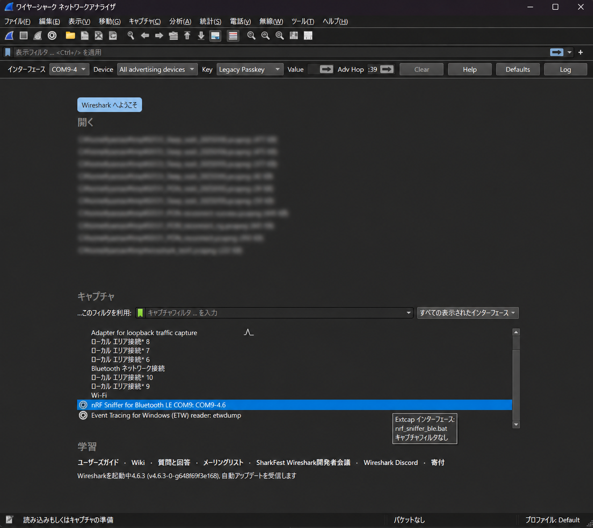
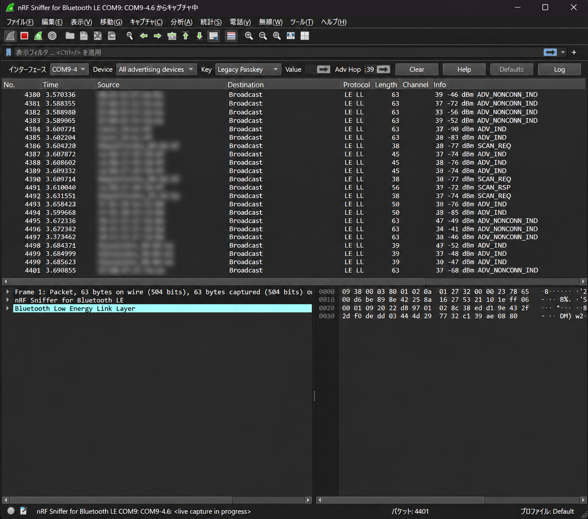

## はじめに

BLE（Bluetooth Low Energy）の無線パケットは、Wiresharkと安価なBLE対応マイコンボードをスニファにしてキャプチャできます。

**スニファ（Sniffer）とは、通信を傍受してパケットを観察・解析するためのツールです。** BLEスニファを使えば、BLE機器が送信する無線パケットを、通信相手として接続せずに確認できます。

BLEを使った電子工作だけでなく、組込み機器の開発や簡易的な通信トラブルの解析にも役立つので、おすすめです。

Nordic Semiconductorが提供する **nRF Sniffer for Bluetooth LE** を利用すれば、対応するnRF52シリーズのデバイスをBLEスニファとして使用できます。

今回は、Nordic SemiconductorのnRF52840を搭載した、技適取得済みの **Seeed Studio XIAO nRF52840** を使用します。

XIAOを選ぶ理由は、次の3点です。

- **技適取得済みの製品である**：日本国内で入手できるBLE対応マイコンボード
- **安価で入手しやすい**：自作の無線キーボードなどでもよく使われている
- **小型で扱いやすい**：USB接続のBLEスニファとして手軽に利用できる

本記事ではXIAO nRF52840（無印）を使用します。XIAO nRF52840 Plusも旧バージョンは動作していますが、今回のSnifferファームウェア 5.0.0 の動作確認は無印で行いました。

XIAOでnRF Snifferを動かす方法は[こちらのQiita記事](https://qiita.com/KentaHarada/items/3e1612116ec45462a837)でも紹介されていますが、現在はファームウェアの配布方法が変わっています。

本記事では、2026年11月時点で取得できる **nRF Sniffer 5.0.0** を使用し、Nordic公式のnRF Utilによるファームウェア取得から、UF2形式への変換、Wiresharkでの動作確認までを紹介します。あわせて、BINからUF2への変換が必要な理由や、フラッシュメモリの配置アドレスについても解説します。

なお、使用するのはNordic純正のnRF52840 Dongle用ファームウェアであって、**XIAO向けの公式ファームウェアではありません。**

## 使用環境

| 項目 | 内容 |
|---|---|
| OS | Windows 11 |
| シェル | PowerShell |
| Python | 3.11.6 |
| ボード | XIAO nRF52840（無印） |
| 対象ボード | XIAO nRF52840 / XIAO nRF52840 Plus |
| nRF Util | 8.1.1 |
| nRF Util BLE Sniffer | 0.22.0 |
| Snifferファームウェア | 5.0.0 |
| UF2変換 | Microsoft uf2conv.py |
| パケット解析 | Wireshark |

XIAO nRF52840には、USB経由でUF2ファイルを書き込めるブートローダが搭載されています。今回は、この仕組みを利用してSnifferファームウェアを書き込みます。

---

## 1. nRF Utilのインストール

以前は、Nordic SemiconductorがnRF Snifferを独立したツールとして配布していましたが、現在は配布方法が変更されています。

そのため、[以前のQiita記事](https://qiita.com/KentaHarada/items/3e1612116ec45462a837)で紹介されているファームウェアの取得手順は、現在ではそのまま利用できません。

**今回は、nRF Snifferのファームウェアを取得するために、nRF Utilを使用します。**

nRF Utilは、Nordic Semiconductorが提供するコマンドラインユーティリティです。

### nRF Utilの入手

公式サイトからWindows版をダウンロードします。

https://www.nordicsemi.com/Products/Development-tools/nRF-Util

ダウンロードした `nrfutil.exe` を任意のディレクトリに配置し、そのディレクトリをPATHに追加します。

例えば、次の場所に配置した場合です。

```text
C:\tools\nrfutil\nrfutil.exe
```

PowerShellで一時的にPATHを追加するには、次のようにします。 (今後もnrfutilを使うなら、恒久的にPATHを通しましょう)

```powershell
$env:PATH = "C:\tools\nrfutil;$env:PATH"
```

これは現在のPowerShellセッションだけに有効な設定です。

動作確認します。

```powershell
nrfutil --version
```

私が確認した環境では、以下のバージョンでした。

```text
nrfutil 8.1.1
```

次の手順では、このnRF Utilを使って、XIAOに書き込むためのSnifferファームウェアを取得します。

---

## 2. BLE Snifferコマンドのインストール

nRF Utilは、必要な機能をコマンド単位で追加する仕組みになっています。

まず、利用可能なコマンドを確認します。

```powershell
nrfutil search
```

続いて、BLE Snifferコマンドをインストールします。この操作で、Snifferファームウェアも取得されます。

```powershell
nrfutil install ble-sniffer
```

インストール済みのコマンドを確認します。

```powershell
nrfutil list
```

今回使用したBLE Snifferのバージョンは0.22.0です。

```text
Command      Version
ble-sniffer  0.22.0
device       2.15.7
```

---

## 3. Snifferファームウェアの取得

BLE Snifferコマンドをインストールすると、Sniffer用ファームウェアも配置されます。

Windowsの標準的なインストール先は次のとおりです。

```text
C:\Users\<ユーザ名>\.nrfutil\share\nrfutil-ble-sniffer\firmware
```

PowerShellで確認します。

```powershell
Get-ChildItem "$HOME\.nrfutil\share\nrfutil-ble-sniffer\firmware"
```

今回取得できたファイルは以下の4つです。

```text
sniffer_nrf52833dk_nrf52833_5.0.0.hex
sniffer_nrf52840dk_nrf52840_5.0.0.hex
sniffer_nrf52840dongle_nrf52840_5.0.0.zip
sniffer_nrf52dk_nrf52832_5.0.0.hex
```

今回は、**nRF52840 Dongle（PCA10059）用のZIPファイル** に含まれるファームウェアを、XIAO nRF52840で書き込めるUF2形式に変換します。
```text
sniffer_nrf52840dongle_nrf52840_5.0.0.zip
```

### UF2変換用BINファイルの取得

まず、作業ディレクトリを作成して移動します。 (ここでは作業ディレクトリは`work`としました) 

```powershell
New-Item -ItemType Directory -Path ".\work" -Force
Set-Location ".\work"
```

続いて、SnifferファームウェアのZIPファイルを展開します。展開先のディレクトリ名は `sniffer_5.0.0` としました。展開には、PowerShell標準の 
`Expand-Archive` コマンドを使用します。

```powershell
Expand-Archive -Path "$HOME\.nrfutil\share\nrfutil-ble-sniffer\firmware\sniffer_nrf52840dongle_nrf52840_5.0.0.zip" -DestinationPath ".\sniffer_5.0.0"
```

展開すると、作業ディレクトリは次の構成になります。

```text
work/
└── sniffer_5.0.0/
    ├── manifest.json
    ├── sniffer_nrf52840dongle_nrf52840.bin
    └── sniffer_nrf52840dongle_nrf52840.dat
```

`sniffer_nrf52840dongle_nrf52840.bin`を、XIAO nRF52840に書き込めるUF2形式に変換します。

## 4. BINからUF2への変換

### uf2conv.pyの取得

変換には、Microsoftが公開しているPython製のUF2変換ツールを使用します。

https://github.com/microsoft/uf2/tree/master/utils

実行にはPython 3が必要です。今回の検証ではPython 3.11.6を使用しました。

以下の2ファイルをダウンロードし、作業ディレクトリ `work` に配置します。

- `uf2conv.py`
- `uf2families.json`

前項で展開したSnifferファームウェアも含め、作業ディレクトリは次の構成になります。

```text
work/
├── uf2conv.py
├── uf2families.json
└── sniffer_5.0.0/
    ├── manifest.json
    ├── sniffer_nrf52840dongle_nrf52840.bin
    └── sniffer_nrf52840dongle_nrf52840.dat
```

### UF2への変換

引き続き、PowerShellで作業ディレクトリ `work` から以下を実行します。

```powershell
python .\uf2conv.py .\sniffer_5.0.0\sniffer_nrf52840dongle_nrf52840.bin --base 0x1000 --family 0xADA52840 --convert --output .\sniffer_5.0.0\flash.uf2
```

実行結果：

```text
Converted to uf2, output size: 164864, start address: 0x1000
Wrote 164864 bytes to .\sniffer_5.0.0\flash.uf2
```

`flash.uf2`が生成されれば変換完了です。

### 補足：BINからUF2への変換について

BINファイルには、フラッシュメモリ上の配置アドレス情報が含まれていません。一方、UF2ファイルには書き込み先アドレスが含まれるため、変換時に配置開始アドレスを指定します。

今回使用したオプションは以下のとおりです。

| オプション | 意味 |
|---|---|
| `--base 0x1000` | BINデータの配置開始アドレス |
| `--family 0xADA52840` | nRF52840のUF2 Family ID |
| `--convert` | UF2形式に変換 |
| `--output` | 出力先ファイル |

`--base` で指定した `0x1000`は、nRF52840 Dongleで使用される、フラッシュメモリ先頭の4KBをMBR用に確保したメモリ配置に対応するアドレスです。

今回のSnifferファームウェア5.0.0も、このアドレスを指定してUF2に変換し、XIAO nRF52840で正常に動作することを確認しました。

---

## 5. XIAO nRF52840への書き込み

XIAO nRF52840をUSBでPCに接続し、リセットボタンを素早く2回押してUF2ブートローダモードに移行します。

ブートローダモードになると、USBストレージとして認識されます。

今回使用したXIAO nRF52840（無印）では、ドライブ名が`XIAO-SENSE`と表示されました。Senseモデルではありませんが、このドライブ名でも問題ありません。

生成した`flash.uf2`をUSBドライブへコピーします。

```powershell
Copy-Item ".\sniffer_5.0.0\flash.uf2" "E:\"
```

※ `E:\`は例です。実際に認識されたUSBドライブのドライブ文字に置き換えてください。

書き込みが完了すると、XIAOは自動的に再起動します。

今回のSnifferファームウェア5.0.0でも、XIAO nRF52840で正常に動作することを確認しました。

---

## 6. WiresharkでBLEパケットをキャプチャする

nRF UtilのBLE Snifferには、Wiresharkとの連携機能があります。

Wiresharkの外部キャプチャ機能（extcap）を設定するため、PowerShellで次のコマンドを実行します。

```powershell
nrfutil ble-sniffer bootstrap --only ble
```

設定後、XIAO nRF52840をPCに接続し、Wiresharkを起動します。

Wiresharkのキャプチャインタフェース一覧に、`nRF Sniffer for Bluetooth LE`が表示されます。



このインタフェースをダブルクリックすると、BLEパケットのキャプチャが開始されます。



今回、Snifferファームウェア5.0.0を使用したXIAO nRF52840で、WiresharkによるBLEパケットのキャプチャが正常に動作することを確認しました。

---

## まとめ

Nordic公式のnRF Utilを使ってBLE Snifferファームウェア5.0.0を取得し、XIAO nRF52840で動作させる方法を紹介しました。

nRF52840 Dongle用のBINファイルをMicrosoftの`uf2conv.py`でUF2形式に変換することで、XIAO nRF52840に書き込むことができます。

Wiresharkとの連携も問題なく、実際にBLEパケットをキャプチャできることを確認しました。

安価なマイコンボードで手軽にBLE通信を観察できるので、電子工作や組込み機器の開発に活用してみてください。

---

## 参考資料

- [Nordic Semiconductor — nRF Util](https://www.nordicsemi.com/Products/Development-tools/nRF-Util)
- [Nordic Developer Academy — nRF Sniffer for Bluetooth LE](https://academy.nordicsemi.com/courses/bluetooth-low-energy-fundamentals/lessons/lesson-6-bluetooth-le-sniffer/topic/nrf-sniffer-for-bluetooth-le/)
- [Nordic — Sniffer firmware files](https://docs.nordicsemi.com/r/bundle/nrfutil/page/nrfutil-ble-sniffer/wireshark_sniffer_requirements.html/sniffer-firmware-files)
- [Microsoft — UF2 / uf2conv.py](https://github.com/microsoft/uf2/tree/master/utils)
- [参考にした既存記事（Qiita）](https://qiita.com/KentaHarada/items/3e1612116ec45462a837)

